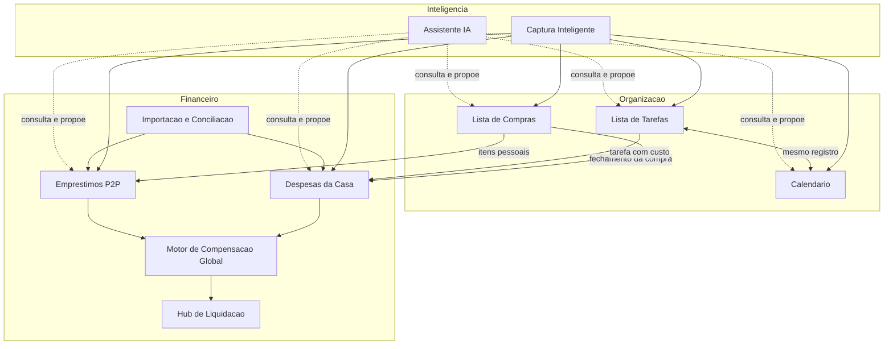

# Omni Lar: Documento Mestre (App Financeiro e Organização da Casa)

> Projeto novo, construído do zero. Nenhum código, modelo ou dado do app Omni será reaproveitado. Este documento organiza todos os módulos já especificados e define a visão geral, as dependências, os princípios e a ordem de construção.

## 1. Visão do Produto

Um aplicativo para pessoas que moram juntas (casal, família, república) organizarem **o dinheiro e a rotina da casa em um só lugar**.

Duas realidades financeiras convivem:
- **O Coletivo:** o Caixa da Casa, um fundo comum que paga as contas.
- **O Individual (P2P):** dívidas e empréstimos diretos entre os membros.

Um **Motor de Compensação Global** cruza as duas e entrega um único fechamento por ciclo (o "Super Pix"). Em volta disso, módulos de organização (agenda, tarefas, compras) e de inteligência (captura, importação, assistente) reduzem a digitação e o atrito.

**Pilares:** simplicidade (lançar em menos de 5 segundos), transparência (todo valor tem origem e prova), justiça (rateio flexível, sem constrangimento) e confirmação humana (a IA sugere, a pessoa decide).

## 2. Mapa dos Módulos

| Grupo | Módulo | Arquivo | Resumo |
|---|---|---|---|
| Financeiro | Despesas da Casa | [modulo_despesas_de_casa.md](modulo_despesas_de_casa.md) | Caixa da Casa, ciclo financeiro, 3 modelos de rateio, provisionamento, VR/VA, cartões |
| Financeiro | Empréstimos P2P | [modulo_emprestimo.md](modulo_emprestimo.md) | Dívidas entre membros: parcelas, pagamento parcial, perdão, renegociação, anexos |
| Financeiro | Projetos & Viagens | [modulo_projetos_compartilhados.md](modulo_projetos_compartilhados.md) | Viagens, reformas, compra de imóvel e eventos com rateio e Super Pix isolados da Casa |
| Financeiro | Integração Global | [integracao_modulo_financeiro.md](integracao_modulo_financeiro.md) | Motor de Compensação, Super Pix, Hub de Liquidação, navegação, Smart FAB |
| Financeiro | Importação e Conciliação | [modulo_importacao_conciliacao.md](modulo_importacao_conciliacao.md) | Fatura de cartão e extrato, "Rachar a Fatura", regras aprendidas |
| Organização | Calendário | [modulo_calendario.md](modulo_calendario.md) | Eventos, participantes necessários, RSVP, recorrência, tarefas com data |
| Organização | Lista de Tarefas | [modulo_lista_de_tarefas.md](modulo_lista_de_tarefas.md) | Responsável, rotinas, rodízio justo, equilíbrio de esforço |
| Organização | Lista de Compras | [modulo_lista_de_compras.md](modulo_lista_de_compras.md) | Listas compartilhadas, modo compra, marcar como comprado, despensa |
| Inteligência | Captura Inteligente | [modulo_captura_inteligente.md](modulo_captura_inteligente.md) | Foto, QR Code da NFC-e, boleto, comprovante, tela de revisão |
| Inteligência | Assistente IA | [modulo_assistente_ia.md](modulo_assistente_ia.md) | Consultas, ações por linguagem natural, alertas proativos |
| Técnico | Arquitetura Técnica | [arquitetura_tecnica.md](arquitetura_tecnica.md) | Autenticação, Supabase (banco, RLS, storage, realtime, functions), pipeline de IA, Flutter, testes, CI, LGPD |

## 3. Arquitetura de Negócio



## 4. Conceitos Centrais (Glossário)

| Termo | Definição |
|---|---|
| Casa | Grupo de membros que compartilha o Caixa, a agenda, as tarefas e as listas |
| Membro | Pessoa com conta, pertencente a uma Casa |
| Caixa da Casa | Fundo comum virtual, abastecido por aportes e que paga as despesas |
| Aporte | Depósito de um membro no Caixa |
| Ciclo Financeiro | Período real da família (ex.: dia 05 ao dia 04), alinhado ao recebimento |
| Fôlego | Saldo livre do Caixa depois de reservar o que vence no ciclo |
| Rateio | Divisão da despesa: porcentagem, valores fixos ou por categoria (dono) |
| Pagamento Cruzado | Um membro paga algo de responsabilidade de outro, gerando acerto |
| Empréstimo P2P | Dívida direta entre membros (a Casa também pode ser credora ou devedora) |
| Motor de Compensação | Cálculo que cruza aportes, reembolsos e dívidas P2P em um saldo líquido por par |
| Super Pix | Pix único de fechamento, derivado do saldo líquido |
| Proposta | Rascunho gerado por captura, importação ou assistente, que só vira dado após confirmação |

## 5. Navegação Global

**Barra inferior (5 abas)**

| Aba | Conteúdo |
|---|---|
| 🏠 A Casa | Dashboard do ciclo, Fôlego, Timeline, cards de Compras e Tarefas |
| 🤝 Pessoal | Empréstimos P2P (o que eu devo, o que me devem) |
| 📅 Agenda | Eventos e tarefas com data |
| 📊 Relatórios | Analytics unificado |
| ⚙️ Ajustes | Rateio, cartões, VR/VA, ciclo, regras aprendidas, assistente |

**Smart FAB (+), agrupado**

| Grupo | Ações |
|---|---|
| Financeiro | 🛒 Gasto da Casa, 💸 Empréstimo, 📥 Aporte, 📄 Importar fatura/extrato |
| Casa | 📅 Evento, ✅ Tarefa, 🛍️ Item de compras |
| Inteligente | 📷 Escanear, ✨ Assistente |

## 6. Regras Transversais

1. **Confirmação humana:** nenhuma captura, importação ou ação do assistente grava dinheiro sem confirmação.
2. **Cálculo determinístico:** valores financeiros vêm sempre do motor do app, nunca de modelo de IA.
3. **Estado derivado:** status de parcelas, eventos e tarefas atrasadas é calculado a partir de dados e eventos, não gravado à mão.
4. **Ledger imutável:** pagamentos e lançamentos financeiros são registros que não se editam. Correções são estornos ou novos lançamentos, e exclusões são lógicas.
5. **Prova anexada:** a imagem original fica ligada ao lançamento e não é alterada.
6. **Permissões e visibilidade:** o que é privado ou restrito nunca aparece para quem não deve, nem para o assistente nem em exportações.
7. **Privacidade:** dados sensíveis (CPF, cartão, conta) são mascarados antes do processamento no servidor. O usuário consente e pode revogar.
8. **Funciona sem IA:** todo fluxo tem alternativa manual. Falha de IA não bloqueia o app.
9. **Offline tolerante:** capturas e lançamentos feitos sem internet entram em fila e sincronizam depois.
10. **Valores em centavos** (inteiros), para evitar erros de arredondamento.
11. **Notificações unificadas:** convites, cobranças, lembretes e alertas seguem o mesmo mecanismo, com deeplink para a tela certa.
12. **IA: código primeiro, IA depois:** o provedor é a Gemini API (Google AI Studio), no plano gratuito por enquanto. QR Code, boleto, OFX e CSV são lidos por código. A IA entra só quando necessário, com cache por hash e limite de uso. No plano gratuito o conteúdo enviado pode ser usado pelo Google, então use apenas dados seus ou fictícios até migrar para o plano pago, antes de convidar outros usuários (veja a seção 17 de [arquitetura_tecnica.md](arquitetura_tecnica.md)).

## 7. Interseções Principais

| Origem | Destino | O que acontece |
|---|---|---|
| Lista de Compras (fechar compra) | Despesas da Casa | Gasto da Casa pré-preenchido (categoria Mercado, rateio padrão) |
| Lista de Compras (itens pessoais) | Empréstimos P2P | Empréstimo para quem pediu o item |
| Captura (nota) | Compras, Despesas, Empréstimos | Marca itens como comprados, preenche valor e separa itens pessoais |
| Captura (boleto) | Despesas | Cria a conta variável com valor, vencimento e beneficiário |
| Captura (comprovante) | Aporte ou parcela P2P | Sugere o vínculo, com confirmação |
| Importação (fatura) | Despesas | Substitui a estimativa pelo valor real do ciclo |
| Importação ("Rachar a Fatura") | Despesas e P2P | Linhas da Casa viram gastos, linhas de outro membro viram empréstimos |
| Tarefa ↔ Calendário | Mesmo registro | Duas visões do mesmo item |
| Tarefa com custo | Despesas ou Compras | Oferece lançar gasto ou adicionar item na lista |
| Despesas + Empréstimos | Motor de Compensação | Saldo líquido e Super Pix no Hub de Liquidação |
| Assistente | Todos | Consulta e propõe ações, respeitando permissões |

## 8. Modelo de Dados Consolidado (Visão Geral)

Cada módulo detalha suas tabelas. Aqui está o que é comum e como se conecta.

**Núcleo**
```
houses(id, name, cycle_start_day)
members(id, house_id, name, contact, role)
payment_methods(id, house_id, owner_id, name, type[card|vr|pix|account], closing_day, due_day)
categories(id, house_id, name, owner_member_id)
attachments(id, owner_type, owner_id, file_url, file_hash, created_by)
notifications(id, member_id, type, payload, deeplink, read_at)
audit_log(id, actor_id, entity_type, entity_id, action, at)
```

**Financeiro**
```
transactions(id, type[house_expense|p2p_loan|payment|contribution], ... )   -- ledger polimórfico
house_expenses, contributions, split_rules
loans, installments, payments, payment_allocations, loan_events
import_batches, import_lines, import_rules
```

**Organização**
```
events, event_participants, event_reminders, event_reschedule_proposals
tasks, task_checklist_items, task_routines, member_absences
shopping_lists, shopping_items, shopping_trips, pantry_history
```

**Inteligência**
```
captures, capture_extractions, capture_items, capture_links
assistant_conversations, assistant_messages, assistant_actions, assistant_preferences
```

**Decisões de modelagem**
- A "Casa" aparece como credora/devedora nos empréstimos (entidade virtual).
- Pagamento é um evento no ledger, com tabela de alocação para as parcelas (suporta pagamento parcial e liquidação em lote).
- Segurança por RLS (Row Level Security): todo dado pertence a uma `house_id` e a visibilidade é aplicada no banco.

## 9. Stack Técnica Prevista

| Camada | Escolha |
|---|---|
| App | Flutter |
| Estado | BLoC/Cubit (a fonte de verdade do Motor de Compensação é o servidor, veja o doc técnico) |
| Rotas | GoRouter, com deeplinks de notificação |
| Backend | Supabase (Postgres, Auth, Storage, Realtime, Edge Functions) |
| Tempo real | Supabase Realtime (listas, convites, respostas) |
| IA | Servidor (Edge Functions), com mascaramento de dados antes do envio |
| Leitura de nota | QR Code da NFC-e primeiro, depois OCR/visão |

> [!IMPORTANT]
> Os detalhes técnicos (autenticação, esquema e RLS do Supabase, Storage, Realtime, Edge Functions, pipeline de IA, estrutura do projeto Flutter, pacotes, testes, CI/CD e LGPD) estão em [arquitetura_tecnica.md](arquitetura_tecnica.md). Em caso de divergência com esta seção, vale o documento técnico.

## 10. Roadmap Sugerido

| Fase | Entrega | Módulos |
|---|---|---|
| 0 | Fundação: autenticação, Casa e Membros, notificações, permissões (RLS), navegação (checklist técnico na seção 16 de [arquitetura_tecnica.md](arquitetura_tecnica.md)) | Núcleo |
| 1 | Financeiro essencial | Despesas da Casa (Caixa, ciclo, rateio), Aportes |
| 2 | Dívidas | Empréstimos P2P (parcelas, parcial, perdão, renegociação, anexos) |
| 3 | Fechamento | Motor de Compensação, Hub de Liquidação, Super Pix, Relatórios |
| 4 | Organização | Lista de Compras (com marcar como comprado), Lista de Tarefas, Calendário |
| 5 | Redução de digitação | Captura Inteligente (QR Code e boleto primeiro, depois foto) |
| 6 | Conciliação | Importação de fatura/extrato, "Rachar a Fatura", regras aprendidas |
| 7 | Assistente | Consultas, depois ações com confirmação, depois proativo e voz |

**Marcos de validação:** ao fim da Fase 3, o casal consegue fechar um ciclo real com um único Pix. Ao fim da Fase 4, o dia a dia da casa roda no app.

## 11. Decisões em Aberto

- A "Casa" como credora/devedora será um membro virtual ou uma entidade própria?
- Alocação de pagamentos: automática (mais antigo primeiro) ou escolha manual?
- Open Finance (conexão direta com bancos) entra no futuro?
- Política de retenção das imagens enviadas (prazo, descarte automático).
- Limite de membros por Casa e modelo de convite (apenas membros, conforme o Calendário).
- Monetização e custos de IA (limites por usuário).
- Lançamento automático pelo assistente: fora desta versão, a reavaliar depois.
- Decisões técnicas (privacidade das dívidas P2P para o admin, motor em Dart ou só servidor, cache local, provedor de IA, plataformas, multi-Casa, moeda): ver a seção 15 de [arquitetura_tecnica.md](arquitetura_tecnica.md).

## 12. Observações sobre os Documentos Existentes

- O item 3.1 de [integracao_modulo_financeiro.md](integracao_modulo_financeiro.md) ainda descreve 4 abas. A seção 6 desse arquivo e este documento valem como referência (5 abas).
- Alguns módulos citam o Omni como exemplo ou origem: o "Importador do Omni" e o "formato já usado pelo Omni" em [modulo_importacao_conciliacao.md](modulo_importacao_conciliacao.md), e o gancho de importador em [modulo_emprestimo.md](modulo_emprestimo.md). Como o projeto parte do zero, essas menções devem ser desconsideradas.
- [ideias_do_omni_repasses.md](ideias_do_omni_repasses.md) foi uma análise do app antigo e não faz parte da especificação.

## 13. Identidade do Produto

| Item | Definição |
|---|---|
| Nome | **Omni Lar** ("omni" = tudo, "lar" = casa: tudo da casa em um só lugar) |
| Relação com o app antigo | Apenas o nome é aproveitado. O projeto é novo e não reutiliza código, modelos ou dados do Omni anterior |
| Slogan (sugestões) | "Tudo da casa, em um só lugar." / "Contas certas, casa em paz." / "Viver junto, sem atrito." |
| Nome do assistente | Em aberto (sugestão: **Vivi**, ou simplesmente "Assistente Omni Lar") |
| Tom de voz | Claro, acolhedor e neutro. Nunca acusatório em cobranças |
| Idioma inicial | Português do Brasil |

**Identificadores técnicos (propostos, a validar antes de publicar)**

| Item | Proposta |
|---|---|
| Pacote Android / Bundle iOS | `br.com.omnilar.app` (não muda depois de publicado) |
| Nome do repositório | `omnilar` |
| Nome do projeto Flutter | `omni_lar` |
| Nome nas lojas | Omni Lar |
| Projetos Supabase | `omnilar-dev`, `omnilar-staging`, `omnilar-prod` |

> [!WARNING]
> O app antigo usa o nome "omni" e a pasta atual do repositório também. Antes de publicar, defina o destino do app antigo (aposentar, renomear ou manter) para evitar conflito de pacote e confusão entre os dois.

**Verificações pendentes do nome**
- [ ] Domínio no Registro.br (`omnilar.com.br`)
- [ ] Disponibilidade na Google Play e na App Store
- [ ] Busca de marca no INPI
- [ ] Contas e usuários em redes sociais
