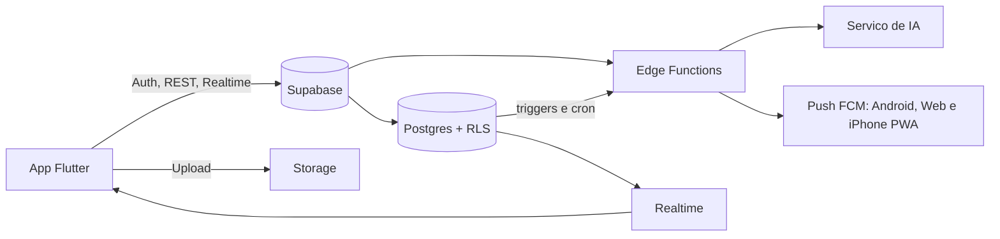

# Documento Técnico: Arquitetura, Supabase e Flutter

> Complementa o [README_documento_mestre.md](README_documento_mestre.md). Projeto novo, do zero. Os valores e escolhas aqui são a **proposta inicial** e podem ser revisados na Fase 0.

## 0. Como ficou implementado (17/10/2026)

As seções 1 a 17 são a proposta escrita antes do código. Onde a implementação seguiu outro caminho, vale esta seção (e, para o detalhe, o código e o [pendencias_proxima_sessao.md](pendencias_proxima_sessao.md)).

| Tema | Proposta | Como ficou |
|---|---|---|
| Cálculo do fechamento (princípio 2, seção 3.4) | Função SQL `fn_compute_settlement`, o app só exibe | O motor roda no app (`global_clearing_engine.dart`); o banco confere o plano e grava tudo numa transação (`confirm_cycle_settlement`). Levar a conta para o banco foi adiado: [fechamento_no_banco.md](fechamento_no_banco.md) |
| Views derivadas (3.4) | `v_installment_status`, `v_cycle_summary`, `v_event_status`, `v_task_status` | Os estados são calculados no domínio do app (Dart puro, com testes) |
| Ambientes (3.2, 12) | `dev`, `staging` e `prod`, migrations por `supabase db push` | Um projeto Supabase só (`rygxmpwzofgieodvhpcy`). Não há Supabase CLI nem Deno na máquina: as migrations são aplicadas pelo conector (antes, à mão pelo SQL Editor) e validadas antes com um bloco que termina em `RAISE EXCEPTION` (rollback) |
| Edge Functions (7) | `capture-read`, `nfce-fetch`, `boleto-parse`, `import-parse`, `import-classify`, `assistant`, `notify`, `scheduler`, `delete-account`, `export-data` | `capture-read`, `nfce-read`, `import-read` (leitura e sugestão de categoria), `assistant` e `notify`. Boleto, OFX e CSV são lidos no app. O agendador é o `pg_cron` chamando funções SQL. `delete-account` e `export-data` não existem |
| Cache e fila offline (10.3, 10.7) | `drift` (SQLite), cache de leitura | Sem cache local: sem rede as listas não carregam. A fila offline (`lib/core/network/`) guarda as ações no `flutter_secure_storage` e reenvia ao voltar a conexão |
| Pacotes (10.3) | `freezed`, `json_serializable`, `drift`, `camera`, `flutter_local_notifications`, `fl_chart` | `equatable` e JSON escrito à mão, `mobile_scanner`, `image_picker`, `file_picker`, `pdf`, `firebase_messaging`, `google_sign_in`; gráficos desenhados com widgets do Flutter |
| Pastas (10.1) | `lib/app`, `lib/shared`, `features/expenses`, `loans`, `tasks`, `import` | `lib/core` (config, di, domain, errors, network, router, security, services, theme, utils, widgets) e `lib/features` (admin, assistant, auth, calendar, capture, finance, home, notifications, p2p, projects, reconciliation, reports, routine, settings, settlement, shopping, splash) |
| Modo demo | — | Cada fonte de dados tem a versão Supabase e a de demonstração (`Dynamic*DataSource`); os testes automatizados rodam só contra a demonstração |
| Realtime (6) | Listas, tarefas, participantes, notificações | Tarefas, itens de compra, despesas, moradores, aportes, empréstimos e parcelas, caixinhas, eventos e participantes, notificações e status da conta |
| Notificações (9) | `notify` grava e envia | O banco grava (`enqueue_notification`, gatilhos e `pg_cron`); a `notify` só envia o push pelo FCM. Detalhe em [plano_notificacoes.md](plano_notificacoes.md) |
| Plataformas (15) | Em aberto | Android (APK) e web (Firebase Hosting, instalável no iPhone); sem App Store |
| Login (2.1) | E-mail, Google, Apple, link mágico | E-mail e senha com código de confirmação; Google pronto e escondido até a publicação; sem Apple. Ver [plano_autenticacao.md](plano_autenticacao.md) |
| Papéis (2.3) | Só na casa | Na casa (dono, administrador, morador) e, acima disso, administrador do app (`platform_admins`), com aprovação de contas e planos ([plano_painel_admin.md](plano_painel_admin.md)) |
| CI (12) | GitHub Actions | Existe (`.github/workflows/ci.yml`): análise e testes do Flutter |
| Observabilidade (14) | Crashlytics ou Sentry | Não há; erros ficam nos logs das Edge Functions e no console do app |

## 1. Visão Geral da Arquitetura



**Princípios técnicos**
1. **Segurança no banco:** toda regra de acesso mora em RLS, não só no app.
2. **Regras financeiras no servidor:** o cálculo de liquidação e saldos roda em funções SQL/Edge, com testes, e o app só exibe. Uma versão em Dart pode existir para simulação offline, mas a fonte de verdade é o servidor.
3. **Ledger imutável:** lançamentos financeiros não sofrem UPDATE nem DELETE físico.
4. **Estado derivado:** status vem de views, não de colunas editadas à mão.
5. **Offline-first moderado:** leitura em cache, escrita em fila para listas, capturas e lançamentos simples.
6. **IA fora do caminho crítico:** o app funciona sem ela.

## 2. Autenticação e Contas

### 2.1. Métodos de login
| Método | Uso |
|---|---|
| E-mail e senha | Padrão |
| Login social (Google; Apple opcional) | Facilita a entrada. Sem App Store, o login Apple deixa de ser obrigatório. No web ele exige conta de desenvolvedor Apple paga (Services ID), então fica fora por enquanto |
| Magic link / OTP por e-mail | Recuperação e convites |
| Biometria local | Camada extra de abertura do app e confirmação de ações de risco (não substitui o login) |

### 2.2. Fluxo de cadastro e convite
1. Usuário cria a conta e o perfil (`profiles`).
2. Cria uma Casa (vira `owner`) ou entra por **convite**.
3. Convite: código ou link de uso único, com validade (ex.: 48 h), ligado a uma `house_id`. Só membros podem ser convidados (regra do Calendário).
4. Ao aceitar, o usuário vira `member` da Casa.

### 2.3. Papéis na Casa
| Papel | Permissões |
|---|---|
| `owner` | Tudo, incluindo remover membros e excluir a Casa |
| `admin` | Gerencia regras de rateio, categorias, ciclo e cartões da Casa |
| `member` | Cria lançamentos, eventos, tarefas e compras. Edita o que criou |

### 2.4. Sessão e segurança
- Tokens JWT do Supabase, com *refresh* automático. Armazenamento em `flutter_secure_storage`.
- Troca de dispositivo e logout remoto (revogar sessões).
- Reautenticação (senha ou biometria) para ações de risco: renegociar, perdoar dívida, liquidar ciclo, excluir conta, exportar dados.
- Rate limit nas rotas sensíveis (login, convite, assistente).
- Exclusão de conta e exportação de dados do usuário (LGPD).

## 3. Supabase: Banco de Dados

### 3.1. Convenções
- Nomes em `snake_case` e inglês. Chaves `uuid` (`gen_random_uuid()`).
- Todo registro de domínio tem `house_id`, `created_at`, `created_by`. Alterações têm `updated_at`.
- Dinheiro em `bigint` (centavos) com `currency` quando necessário. Nunca `float`.
- Exclusão lógica (`deleted_at`) onde o histórico importa. Nenhum DELETE físico em tabelas financeiras.
- Datas em `timestamptz` (UTC) e `date` para vencimentos. A Casa tem `timezone`.
- Enums como tipos Postgres ou tabelas de domínio, versionados em migrações.

### 3.2. Organização das migrações
- Uma pasta `supabase/migrations`, arquivos sequenciais, aplicados por CLI (`supabase db push`).
- Ambientes separados: `dev`, `staging`, `prod`.
- Seeds apenas em dev (categorias padrão, membro de teste).

### 3.3. Esquemas por domínio (resumo)
| Domínio | Tabelas principais |
|---|---|
| Núcleo | `profiles`, `houses`, `house_members`, `house_invites`, `payment_methods`, `categories`, `attachments`, `notifications`, `audit_log` |
| Financeiro | `house_expenses`, `contributions`, `split_rules`, `transactions`, `loans`, `installments`, `payments`, `payment_allocations`, `loan_events`, `settlements` |
| Importação | `import_batches`, `import_lines`, `import_rules` |
| Agenda | `events`, `event_participants`, `event_reminders`, `event_reschedule_proposals` |
| Tarefas | `tasks`, `task_checklist_items`, `task_routines`, `task_routine_members`, `member_absences`, `task_comments` |
| Compras | `shopping_lists`, `shopping_items`, `shopping_trips`, `pantry_history` |
| Captura e IA | `captures`, `capture_extractions`, `capture_items`, `capture_links`, `assistant_conversations`, `assistant_messages`, `assistant_actions`, `assistant_preferences` |

### 3.4. Views e funções derivadas
- `v_installment_status`: saldo pendente, pago, parcial, vencida, perdoada, futura (a partir de `payments` e `payment_allocations`).
- `v_cycle_summary`: aportes, despesas, comprometido e fôlego por ciclo.
- `v_event_status`: Aguardando, Confirmado, Em Risco ou Cancelado, a partir das respostas dos necessários.
- `v_task_status`: inclui Atrasada.
- `fn_compute_settlement(house_id, cycle)`: o **Motor de Compensação**. Devolve o saldo líquido por par de membros e as transferências mínimas (o Super Pix).
- `fn_settle_cycle(...)`: grava a liquidação de forma atômica (transação) e carimba parcelas e faturas como pagas.

### 3.5. Integridade
- Constraints: valores positivos, `due_date >= start`, soma das alocações ≤ valor do pagamento.
- Triggers: preencher `updated_at`, gravar `audit_log`, impedir UPDATE/DELETE em ledger.
- Índices por `(house_id, data)` e por chaves de busca (`due_date`, `status`).

## 4. Supabase: RLS (Row Level Security)

### 4.1. Regra base
RLS **ativado em todas as tabelas**. Sem política, ninguém acessa. Uma função auxiliar identifica a Casa do usuário:

```sql
create function public.is_house_member(h uuid) returns boolean
language sql security definer stable as $$
  select exists (
    select 1 from house_members
    where house_id = h and user_id = auth.uid() and left_at is null
  );
$$;
```

Política típica (leitura e criação por membros da mesma Casa):
```sql
create policy "members read" on house_expenses for select
  using (public.is_house_member(house_id));
create policy "members insert" on house_expenses for insert
  with check (public.is_house_member(house_id) and created_by = auth.uid());
```

### 4.2. Regras por tipo de dado
| Dado | Leitura | Escrita |
|---|---|---|
| Despesas, aportes, categorias | Membros da Casa | Membros criam. `admin` altera regras |
| Ledger (`payments`, `transactions`) | Membros da Casa | Só INSERT. UPDATE/DELETE bloqueados |
| Empréstimos P2P | Credor, devedor (e `admin` apenas no agregado) | Credor cria. Devedor aceita. Eventos controlam o estado |
| Eventos `house` | Membros da Casa | Criador edita. Participante só responde RSVP |
| Eventos `restricted` | Criador e participantes | Idem |
| Eventos `private`, tarefas `private` | Somente o criador | Somente o criador |
| Tarefas | Membros da Casa (exceto privadas) | Criador e responsável |
| Listas de compras | Membros da Casa | Membros |
| Capturas e anexos | Quem enviou e quem tem acesso ao lançamento vinculado | Quem enviou |
| Conversas do assistente | Somente o dono | Somente o dono |

### 4.3. Pontos de atenção
- Dívidas P2P entre dois membros **não** devem ser visíveis aos demais (a Casa só vê totais, se a regra permitir). Definir isso na Fase 2.
- Funções `security definer` usam `search_path` fixo e validam `auth.uid()` internamente.
- Toda mudança de política tem teste automatizado (pgTAP ou testes de integração com usuários diferentes).
- A chave `service_role` nunca vai para o app. Fica só nas Edge Functions.

## 5. Supabase: Storage

| Bucket | Conteúdo | Acesso |
|---|---|---|
| `attachments` | Notas, comprovantes, boletos, fotos de tarefas | Privado, URL assinada com expiração curta |
| `imports` | Faturas e extratos (PDF, OFX, CSV) | Privado, descarte automático após conciliação (configurável) |
| `avatars` | Fotos de perfil | Público ou assinado |

- Caminho com prefixo da Casa (`{house_id}/{entity}/{id}/{arquivo}`), e políticas de Storage que checam a Casa.
- Hash do arquivo (`file_hash`) para detectar duplicidade.
- Limites de tamanho e tipo (MIME) validados no servidor.
- Imagens redimensionadas e comprimidas no app antes do envio.

## 6. Supabase: Realtime

- Canais por Casa e por tabela: `shopping_items`, `tasks`, `event_participants`, `notifications`.
- RLS vale também para o Realtime.
- Reconexão automática e reconciliação por `updated_at` ao voltar online.
- Evitar canais em tabelas pesadas (ledger) e usar consulta sob demanda.

## 7. Supabase: Edge Functions

| Função | Responsabilidade |
|---|---|
| `capture-read` | Recebe a imagem, aplica mascaramento, chama OCR/visão, devolve JSON e confiança |
| `nfce-fetch` | Consulta os dados de uma NFC-e a partir do QR Code |
| `boleto-parse` | Valida linha digitável e dígito verificador |
| `import-parse` | Lê OFX/CSV/PDF e normaliza as linhas |
| `import-classify` | Sugere categoria, dono e rateio |
| `assistant` | Orquestra o assistente: contexto, ferramentas (tools) e Cartão de Confirmação |
| `notify` | Grava em `notifications` e envia push pelo FCM (API HTTP v1) para Android, web e iPhone instalado, conforme eventos e preferências |
| `scheduler` | Tarefas agendadas (lembretes, rotinas, ciclo virando, contas recorrentes) via `pg_cron` |
| `delete-account` / `export-data` | LGPD |

**Regras**
- Segredos (chaves de IA, FCM) em *secrets* do Supabase, nunca no app.
- Validação de entrada (schema) e verificação do JWT em todas as funções.
- Registro de custo e uso por usuário (limite diário) para a IA.
- Idempotência (chave por requisição) para evitar lançamentos duplicados em reenvio.

## 8. Pipeline de IA

1. **Entrada:** imagem, arquivo ou texto do usuário.
2. **Pré-processamento no app:** compressão e remoção de metadados (EXIF).
3. **Mascaramento no servidor:** CPF, número de cartão e dados de conta.
4. **Extração:** QR Code ou arquivo estruturado primeiro, depois visão/OCR e LLM com saída em JSON validado por schema.
5. **Normalização e classificação:** nomes, categorias, dono, rateio, com regras aprendidas.
6. **Proposta:** gravada em `captures` / `import_lines` com confiança por campo.
7. **Revisão humana e confirmação:** só então vira lançamento, via função transacional.

**Assistente**
- O modelo só chama **ferramentas** expostas (consultar saldo, criar item, criar evento...). Cada ferramenta executa com o JWT do usuário, então a RLS se aplica.
- Ações de escrita retornam uma **proposta** (`assistant_actions` em `proposed`). A escrita real ocorre quando o app envia a confirmação.
- Respostas numéricas vêm de funções SQL (determinísticas), nunca de cálculo do modelo.
- Logs sem conteúdo sensível, e retenção configurável.

## 9. Notificações

Tudo sobre notificações está em [plano_notificacoes.md](plano_notificacoes.md): princípios, estrutura no banco e no app, envio pelo FCM, **iPhone e Apple (seção 3.4: site instalado, sem APNs nem App Store)**, catálogo de todas as notificações e decisões pendentes.

## 10. Flutter: Arquitetura

### 10.1. Organização por funcionalidade (feature-first)
```
lib/
  app/                    # bootstrap, tema, MaterialApp, DI
  core/
    config/               # ambientes (dev/staging/prod)
    error/                # Failure, exceções, mapeamento de erros
    network/              # cliente Supabase, interceptors
    storage/              # secure storage, cache local
    money/                # tipo Money (centavos), formatação
    router/               # GoRouter, guards, deeplinks
    utils/
  shared/                 # widgets, extensões, design system
  features/
    auth/
    house/                # casa, membros, convites
    expenses/             # despesas da casa, aportes
    loans/                # empréstimos P2P
    settlement/           # motor de compensação, Hub de Liquidação
    calendar/
    tasks/
    shopping/
    capture/
    import/
    assistant/
    reports/
    settings/
      (cada feature)
      data/               # datasources (Supabase), DTOs, repositórios (impl)
      domain/             # entidades, interfaces de repositório, casos de uso
      presentation/       # cubits, páginas, widgets
```

### 10.2. Camadas e dependências
```
presentation (Cubit/Widget) -> domain (entidades, use cases) <- data (Supabase, cache)
```
- `domain` não conhece Flutter nem Supabase (Dart puro, fácil de testar).
- Repositórios são interfaces no `domain` e implementações no `data`.
- Erros viram `Failure` tipado (rede, permissão, validação, conflito), e a UI mostra mensagens claras.

### 10.3. Pacotes sugeridos
| Necessidade | Pacote |
|---|---|
| Estado | `flutter_bloc` (Cubit na maioria, Bloc para fluxos com eventos) |
| Rotas e deeplinks | `go_router` |
| Backend | `supabase_flutter` |
| Injeção de dependência | `get_it` (+ `injectable`, opcional) |
| Modelos imutáveis e JSON | `freezed`, `json_serializable` |
| Valores e igualdade | `equatable` (ou Freezed) |
| Cache e fila offline | `drift` (SQLite) |
| Armazenamento seguro | `flutter_secure_storage` |
| Biometria | `local_auth` |
| Câmera e QR Code | `camera`, `mobile_scanner` |
| Seleção e compressão de imagem | `image_picker`, `flutter_image_compress` |
| Notificações | `firebase_messaging` (Android e web/PWA), `flutter_local_notifications` (só Android, para avisos com o app aberto) |
| Internacionalização | `intl`, `flutter_localizations` (pt-BR primeiro) |
| Gráficos | `fl_chart` |
| Testes | `flutter_test`, `bloc_test`, `mocktail` |

### 10.4. Estado (BLoC/Cubit)
- Um Cubit por tela ou fluxo, estados imutáveis (`freezed`) com `initial / loading / success / failure`.
- Evitar lógica de negócio nos widgets. Ela fica em casos de uso e no domínio.
- Cubits que dependem de outros (Fôlego depende de despesas e aportes) consomem repositórios, não outros cubits.
- Streams do Realtime viram estados via repositório.

### 10.5. Navegação (GoRouter)
- Shell com 5 abas (`StatefulShellRoute`), preservando a pilha de cada aba.
- *Guards*: não autenticado vai para login. Sem Casa vai para criar ou entrar. Ações de risco passam por reautenticação.
- Deeplinks documentados, por exemplo:
  - `/home`
  - `/p2p/loan/:id`
  - `/agenda/event/:id`
  - `/settlement/:cycleId`
  - `/capture/review/:id`
- Smart FAB abre *bottom sheet* agrupado (Financeiro, Casa, Inteligente).

### 10.6. Dinheiro e datas
- Tipo `Money` (centavos, `int`) com formatação pt-BR. Proibido `double` para valores.
- Ciclo financeiro e fechamento de cartão calculados em um único módulo de domínio, com testes de borda (fim de mês, ano bissexto, virada de fuso).
- Fuso horário da Casa para vencimentos e lembretes.

### 10.7. Offline e sincronização
- Cache local (`drift`) para listas, tarefas, agenda e últimos lançamentos.
- Fila de escrita para ações simples, com `client_id` para idempotência.
- Capturas offline ficam na fila e são enviadas ao reconectar.
- Resolução de conflito: *último vence* para campos simples (nome de item), *servidor decide* para finanças e RSVP.
- Operações financeiras críticas (liquidar ciclo, perdoar) exigem conexão.

### 10.7.1. Tratamento de erros e estados vazios
- Toda tela tem estados de carregamento, vazio, erro e sem conexão.
- Mensagens em linguagem simples, com ação de tentar novamente.

### 10.8. Design system
- Tema claro e escuro, tokens de cor, tipografia e espaçamento.
- Componentes compartilhados: cartão de dinheiro, barra de Fôlego, avatar de membro, chip de status, cartão de confirmação, tela de revisão.
- Acessibilidade: contraste, tamanhos de toque, leitores de tela, escala de fonte.
- Cores semânticas das abas P2P (vermelho "devo", verde "me devem") sem depender só da cor (ícone e texto).

## 11. Qualidade e Testes

| Camada | Testes |
|---|---|
| Domínio (Dart puro) | Unitários: rateio, ciclo, parcelas, estados derivados |
| Motor de Compensação | Casos de teste dos docs (ex.: aporte 500 − reembolso 200 + P2P 100 = Pix de 400) |
| Banco | Testes de RLS por papel e de funções SQL (pgTAP) |
| Cubits | `bloc_test` com repositórios simulados |
| Widgets | Golden tests das telas principais |
| Integração | Fluxos de ponta a ponta (lançar gasto, fechar ciclo, convidar membro) |
| IA | Conjunto fixo de notas, boletos e faturas com saída esperada e métricas de acerto |

- Cobertura mínima no domínio e nas funções financeiras (meta alta). Nenhuma regra de dinheiro sem teste.
- Os casos de teste listados em cada documento de módulo viram os testes iniciais.

## 12. CI/CD e Ambientes

- Repositório com *pipeline* (GitHub Actions): `flutter analyze`, `dart format --set-exit-if-changed`, testes, geração de código, build.
- Migrações do Supabase validadas em banco temporário a cada PR.
- Ambientes `dev`, `staging` e `prod`, com projetos Supabase separados e `--dart-define` para configuração.
- Distribuição: Firebase App Distribution para testadores Android. No iPhone, os testadores usam a versão web instalada na Tela de Início (sem TestFlight, que exige conta Apple paga).
- Versionamento semântico e *changelog*.

## 13. Segurança e Privacidade (LGPD)

- Mínimo de dados necessários. Mascaramento antes de enviar a terceiros (IA).
- Consentimento explícito para leitura de imagens e uso do assistente, revogável.
- Criptografia em trânsito (TLS) e em repouso (padrão Supabase).
- Logs sem dados sensíveis. Retenção definida para imagens e conversas.
- Direitos do titular: exportar e excluir dados (Edge Functions dedicadas).
- Proteção contra abuso: rate limit, limite de tamanho de upload, validação de MIME.
- Auditoria (`audit_log`) em ações financeiras e de permissão.
- Revisão de dependências e segredos (varredura no CI).

## 14. Observabilidade

- Crashlytics (ou Sentry) para erros do app.
- Logs das Edge Functions e métricas de latência e custo da IA.
- Painel de saúde: falhas de leitura, fila de capturas, notificações não entregues.
- Eventos de uso anônimos (opt-in) para medir os fluxos principais (tempo de lançamento, taxa de confirmação de propostas).

## 15. Decisões Técnicas em Aberto

| Tema | Pergunta |
|---|---|
| Privacidade P2P | O `admin` vê as dívidas entre dois membros ou só totais? |
| Motor de cálculo | Só no servidor, ou também em Dart para simulação offline? |
| Cache local | `drift` (SQLite) ou `hive/isar`? |
| IA | Provedor definido: Gemini API (Google AI Studio), começando no plano gratuito. Ver seção 17 (limites, privacidade e migração para o plano pago) |
| Plataformas | Só mobile, ou também web/desktop? |
| Multi-Casa | Um usuário pode pertencer a mais de uma Casa? |
| Moeda | Apenas BRL ou multi-moeda? |
| Open Finance | Entra em fase futura? |

## 16. Checklist da Fase 0 (Fundação)

> Lista original, mantida como registro. A fundação foi construída com as mudanças da seção 0 (um ambiente só, sem Apple, sem observabilidade).

- [ ] Projeto Supabase (dev/staging/prod) e CLI configurados
- [ ] Esquema do núcleo (`profiles`, `houses`, `house_members`, `house_invites`) com RLS e testes
- [ ] Auth (e-mail, Google, Apple) e fluxo de convite
- [ ] Projeto Flutter com estrutura feature-first, tema e DI
- [ ] GoRouter com shell de 5 abas e guards
- [ ] Tipo `Money` e utilitário de ciclo, com testes
- [ ] Notificações (token, push de teste no Android e no iPhone instalado, deeplink)
- [ ] CI com análise, testes e validação de migrações
- [ ] Observabilidade básica (Crashlytics/Sentry)

## 17. IA com Gemini API (Google AI Studio, plano gratuito)

### 17.1. Decisão
O provedor de IA é a **Gemini API**, com a chave criada no Google AI Studio. O projeto começa no **plano gratuito** (desenvolvimento, testes e uso próprio), com migração planejada para o plano pago quando houver usuários reais.

> [!WARNING]
> **Privacidade no plano gratuito:** segundo a página de preços da Gemini API, no plano gratuito o conteúdo enviado pode ser usado para melhorar os produtos do Google. No plano pago, não. Faturas, extratos, notas e boletos são dados sensíveis. Por isso, **no plano gratuito use apenas dados seus ou fictícios**. Antes de convidar outros usuários, migre para o plano pago (ou ative o faturamento no projeto), e atualize o texto de consentimento.

### 17.2. Como se encaixa na arquitetura
- A chave da API fica **somente nos *secrets* das Edge Functions**, nunca no app Flutter.
- O app chama a Edge Function, que chama a Gemini API (REST ou SDK). Isso mantém o mascaramento, a validação do JWT, a idempotência e o controle de uso em um só lugar.
- Uma camada `AiProvider` (interface) isola o provedor. Trocar de modelo, de plano ou de provedor não altera as demais funções.

```
Edge Function (capture-read, import-classify, assistant)
   -> AiProvider (interface)
        -> GeminiProvider (implementação: modelo, chave, retries)
```

### 17.3. Escolha de modelos
Os nomes e limites mudam com frequência. Confira sempre a página de modelos e a de limites do AI Studio antes de fixar. A regra de uso é:

| Tarefa | Perfil de modelo |
|---|---|
| Ler nota, boleto, fatura (visão) e extrair JSON | Modelo da família **Flash** com entrada de imagem/PDF e saída estruturada |
| Classificar linhas e normalizar nomes | Modelo **Flash** ou **Flash-Lite** (mais barato e rápido) |
| Assistente (conversa e ferramentas) | Modelo **Flash**, com *function calling* |
| Casos difíceis, com baixa confiança | Reenvio opcional a um modelo maior (Pro), apenas sob demanda |

O nome do modelo fica em configuração (`AI_MODEL_VISION`, `AI_MODEL_CHAT`, `AI_MODEL_CLASSIFY`), não no código.

### 17.4. Recursos da Gemini API que ajudam
- **Entrada multimodal:** imagem e PDF direto no prompt (nota, boleto, fatura), sem uma etapa de OCR separada na maioria dos casos.
- **Saída estruturada (JSON Schema):** força o formato da resposta, e o servidor valida de novo antes de gravar.
- **Function calling:** o assistente chama as ferramentas do app (consultar saldo, criar item) e a Edge Function executa com o JWT do usuário.
- **Instruções de sistema e exemplos:** fixam tom, idioma (pt-BR) e regras ("nunca calcule valores, use as ferramentas").

### 17.5. Limites do plano gratuito e como lidar
O plano gratuito tem limites por projeto (requisições por minuto, por dia e tokens por minuto), que dependem do modelo e podem mudar. Os valores atuais aparecem no painel do AI Studio.

| Risco | Mitigação |
|---|---|
| Estourar o limite (erro 429) | Fila com *retry* e *backoff* exponencial. Mensagem amigável ("tente em instantes") e alternativa manual |
| Pico de uso (vários membros escaneando) | Limite por usuário e por Casa por dia, controlado em `ai_usage` |
| Latência de imagens grandes | Compressão no app e redução de resolução antes do envio |
| Custo ao migrar para o pago | Cache de resultados por `file_hash`, modelos Flash-Lite para classificação, e chamadas só quando a fonte estruturada (QR Code, OFX/CSV) não resolve |
| Indisponibilidade | Fallback manual em todos os fluxos (princípio "funciona sem IA") |

Tabela de controle sugerida:
```
ai_usage(id, house_id, member_id, feature[capture|import|assistant], model,
         tokens_in, tokens_out, status, created_at)
```

### 17.6. Economizar chamadas (importante no plano gratuito)
1. **QR Code da NFC-e, OFX e CSV não usam IA** para extração. Só a classificação opcional usa.
2. **Boleto:** a linha digitável e o código de barras são lidos por código (validação do dígito verificador). A IA só entra se for foto ilegível.
3. **Cache por hash:** o mesmo arquivo nunca é enviado duas vezes.
4. **Lote:** classificar várias linhas de fatura em uma única chamada, com saída em JSON.
5. **Regras aprendidas primeiro:** estabelecimentos já conhecidos não vão para a IA.
6. **Assistente:** consultas comuns ("o que vence esta semana?") podem usar atalhos e botões que chamam funções SQL direto, sem LLM.

### 17.7. Dados enviados e privacidade
- Mascarar CPF, número de cartão e dados de conta antes do envio (já previsto no pipeline).
- Remover metadados da imagem (EXIF).
- Enviar só o necessário: para classificar linhas, mandar descrição e valor, sem nome do titular.
- Registrar em `ai_usage` apenas metadados (sem conteúdo do documento).
- Consentimento explícito no app, com texto que explique o provedor (Google) e, no plano gratuito, que o conteúdo pode ser usado para melhoria dos produtos.

### 17.8. Plano de migração para produção
| Etapa | Ação |
|---|---|
| Desenvolvimento | Plano gratuito, dados fictícios e seus |
| Beta fechado | Ainda gratuito, apenas com pessoas que aceitem o termo, ou já no pago |
| Lançamento | Faturamento ativo no projeto (plano pago), com orçamento e alertas de gasto |
| Escala | Limites por Casa, cache agressivo e revisão do modelo por tarefa |

### 17.9. Testes específicos de IA
- Conjunto fixo de notas, boletos e faturas **fictícios** com a saída esperada, executado a cada mudança de modelo ou de prompt.
- Métricas: acerto por campo, taxa de baixa confiança, taxa de correção pelo usuário.
- Testes de falha: erro 429, resposta fora do schema, timeout e imagem ilegível devem cair no fallback manual.
