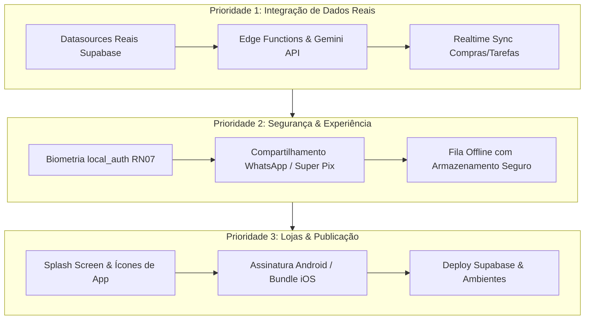

# 📋 Omni Lar: Roadmap de Pendências para Produção

Este documento consolida o estado atual do desenvolvimento e mapeia com clareza **todas as etapas restantes** para transformar o aplicativo em um produto 100% pronto para publicação nas lojas (Google Play e App Store) e uso diário por famílias e repúblicas.

---

## 1. Status Atual do Projeto

| Área / Módulo | Status | Cobertura de Testes |
|---|---|---|
| **Fase 0 — Fundação** (Auth, Casa, Membros, Router, Shell) | Concluído ✅ | 100% |
| **Fase 1 — Despesas da Casa** (Caixa, Fôlego, Rateio, Aportes) | Concluído ✅ | 100% |
| **Fase 2 — Empréstimos P2P** (Parcelas, Parcial, Perdão, Renegociação) | Concluído ✅ | 100% |
| **Fase 3 — Motor de Fechamento** (Global Clearing Engine / Super Pix) | Concluído ✅ | 100% |
| **Fase 4 — Organização** (Compras, Pessoal P2P, Agenda, Tarefas) | Concluído ✅ | 100% |
| **Fase 5 — Captura Inteligente** (Boleto 47 dígitos, NFC-e, Revisão) | Concluído ✅ | 100% |
| **Fase 6 — Conciliação** (Extratos CSV, "Rachar a Fatura" RN09) | Concluído ✅ | 100% |
| **Fase 7 — Assistente de IA** (Chat, Motor Determinístico, Confirmação) | Concluído ✅ | 100% |
| **Ajustes & Configurações** (Categorias com Dono, Cartões/VR, Rateio, Ciclo) | Concluído ✅ | 100% |
| **Humanização & UX** (Input ATM centavos, Modo Privacidade, 3 Colunas) | Concluído ✅ | 100% |
| **Backend & Infra SQL** (Migrações 0001 a 0004 com RLS, Fila Offline) | Concluído ✅ | 100% |

> **Métrica de Confiabilidade:** **56 testes automatizados (unitários e widgets) passando (100% verde)** e `flutter analyze` sem nenhum erro ou aviso.

---

## 2. Matriz de Pendências para Produção

Abaixo estão divididos por prioridade técnica os blocos de trabalho que restam ser implementados:

---

## 3. Detalhamento por Frente de Trabalho

### Frente 1: Conexão Real com o Backend (Supabase & Edge Functions)
Atualmente, o app utiliza **DataSources Mockados** altamente consistentes em memória para permitir desenvolvimento e testes ágeis sem dependência de rede.

- [ ] **DataSources Reais de Banco:**
  - Substituir os `Mock*DataSource` por implementações que chamam `supabase.from('...')`:
    - `SupabaseFinanceDataSource` (`house_expenses`, `contributions`, `categories`).
    - `SupabaseP2PDataSource` (`loans`, `installments`, `payments`).
    - `SupabaseShoppingDataSource` (`shopping_lists`, `shopping_items`, `shopping_trips`).
    - `SupabaseCalendarDataSource` (`events`, `tasks`).
- [ ] **Supabase Realtime:**
  - Plugar streams de Realtime nas listas de compras e tarefas para que alterações feitas por um parceiro reflitam instantaneamente no dispositivo do outro sem recarregar.
- [ ] **Edge Functions (Deno / TypeScript):**
  - Subir a Edge Function `capture-read` com o SDK do Google Gemini (usando `AI_MODEL_VISION`).
  - Configurar secret `GEMINI_API_KEY` apenas no cofre seguro do Supabase (nunca no app).

---

### Frente 2: Segurança e Confirmação de Risco (RN07)
A especificação do projeto prevê que ações de alto impacto financeiro não possam ser disparadas acidentalmente.

- [ ] **Integração com `local_auth`:**
  - Adicionar o pacote `local_auth` ao `pubspec.yaml`.
  - Exigir biometria (Fingerprint / Face ID) ou PIN do aparelho ao:
    - Executar **Perdão de Empréstimo (Anistia)**.
    - Executar **Renegociação de Dívida**.
    - Executar **Liquidação do Ciclo Financeiro (Fechar Ciclo)**.

---

### Frente 3: Compartilhamento e Notificações Push
O objetivo do Omni Lar é "viver junto sem atrito". Para isso, a comunicação entre os moradores precisa ser fluida.

- [ ] **Compartilhamento do Super Pix (Comprovante / Veredito):**
  - Implementar botão de compartilhamento no `SettlementHubPage` gerando texto pré-formatado e educado:
    > *"Fechamento do ciclo concluído! Segundo o Omni Lar, Carlos precisa transferir R$ 180,00 via Pix para Marina para quitar todos os gastos da casa e empréstimos pessoais."*
- [ ] **Notificações Push (FCM / APNs):**
  - Configurar Firebase Cloud Messaging para Android e APNs para iOS.
  - Enviar pushes para: novo empréstimo solicitado, tarefa atribuída e proximidade do fechamento do ciclo.

---

### Frente 4: Assets, Identidade Visual e Lojas
Preparar o binário para distribuição pública.

- [ ] **Ícone do Aplicativo e Splash Screen:**
  - Configurar `flutter_launcher_icons` com o logo oficial do Omni Lar em todas as densidades (Android adaptativo e iOS).
  - Configurar `flutter_native_splash` para remover o flash branco inicial na inicialização do Flutter.
- [ ] **Configurações de Build:**
  - Definir `applicationId = "br.com.omnilar.app"` no Android (`build.gradle`).
  - Criar `key.properties` e keystore para release.
  - Configurar Bundle Identifier no iOS Runner (`br.com.omnilar.app`).
- [ ] **Verificações de Marca e Domínio:**
  - Registro de domínio institucional e contas de suporte para atendimento a usuários e conformidade com os termos da Google Play / Apple Store.

---

## 4. Ordem Recomendada de Execução

1. **Sprint 1 (Conexão Supabase):** Criar os repositórios reais do Supabase e ligá-los no `ServiceLocator`.
2. **Sprint 2 (Segurança & Compartilhamento):** Adicionar biometria nas ações de risco e botão de enviar o Pix no WhatsApp.
3. **Sprint 3 (Realtime & Edge Functions):** Ativar a sincronização em tempo real e subir o OCR na nuvem.
4. **Sprint 4 (Assets & Publicação):** Gerar ícones, splash, assinar app e gerar builds release (`.aab` e `.ipa`).
