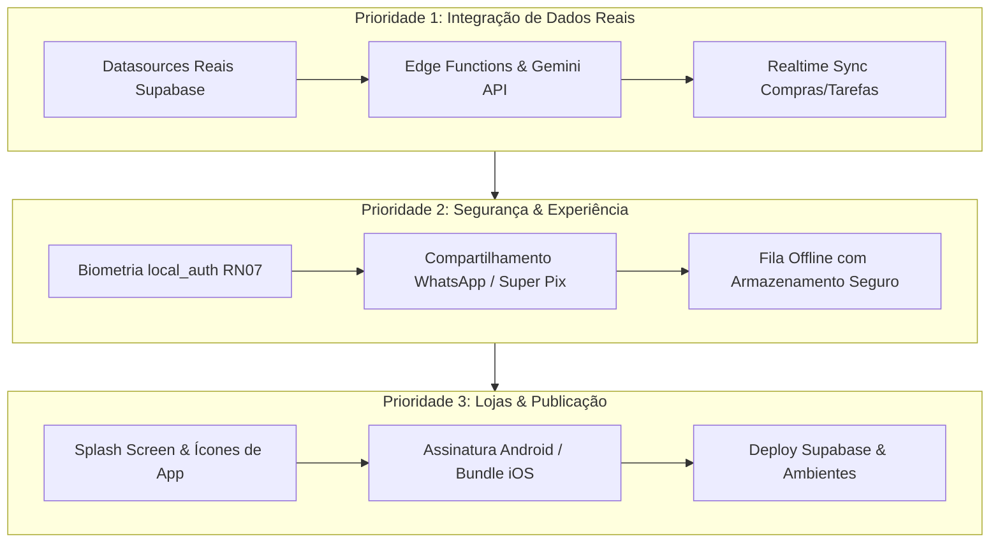

# 📋 Omni Lar: Roadmap de Pendências para Produção

Este documento consolida o estado atual do desenvolvimento e mapeia com clareza **todas as etapas restantes** para transformar o aplicativo em um produto 100% pronto para publicação nas lojas (Google Play e App Store) e uso diário por famílias e repúblicas.

---

## 1. Status Atual do Projeto

| Área / Módulo | Status | Cobertura de Testes |
|---|---|---|
| **Fase 0 — Fundação** (Auth, Casa, Membros, Router, Shell) | Concluído ✅ | 100% |
| **Fase 1 — Despesas da Casa** (Caixa, Fôlego, Rateio, Aportes) | Concluído ✅ | 100% |
| **Fase 1.1 — Despesas Recorrentes & Assinaturas** (Fixas, Variáveis, Fôlego e Gestão) | Concluído ✅ | 100% |
| **Fase 2 — Empréstimos P2P** (Parcelas 1x-12x, Parcial, Perdão, Renegociação) | Concluído ✅ | 100% |
| **Fase 3 — Motor de Fechamento** (Global Clearing Engine / Super Pix) | Concluído ✅ | 100% |
| **Fase 4 — Organização** (Agenda do Lar com Visão Dia/Semana/Mês/Lista, Seção Tarefas & Compras, Pessoal P2P) | Concluído ✅ | 100% |
| **Fase 5 — Captura Inteligente** (Boleto 47 dígitos, NFC-e, Revisão) | Concluído ✅ | 100% |
| **Fase 6 — Conciliação** (Extratos CSV, "Rachar a Fatura" RN09) | Concluído ✅ | 100% |
| **Fase 7 — Assistente de IA** (Chat, Motor Determinístico, Confirmação) | Concluído ✅ | 100% |
| **Ajustes & Configurações** (Categorias com Dono, Cartões/VR, Rateio Fixo/Proporcional, Ciclo) | Concluído ✅ | 100% |
| **Caixinhas & Metas da Casa** (Reserva Blindada, Metas com Progresso, Aportes/Resgates) | Concluído ✅ | 100% |
| **Humanização & UX** (Input ATM centavos nativo, Modo Privacidade, 3 Colunas) | Concluído ✅ | 100% |
| **Despesas Compostas & Boletos Segmentados** (Condomínio com Água, Gás e Obras) | Concluído ✅ | 100% |
| **Despesas Retroativas & Contas Atrasadas** (Vencidas, Carry-forward de Passivos, Alertas) | Concluído ✅ | 100% |
| **Eventos & Despesas Recorrentes** (3 Escopos de Edição/Exclusão RFC 5545) | Concluído ✅ | 100% |
| **Projetos & Viagens Compartilhadas** (Isolamento da Casa, Rateio Próprio, Super Pix) | Concluído ✅ | 100% |
| **Backend & Infra SQL** (Migrações 0001 a 0006, RLS, Views Seguras e RPCs) | Concluído ✅ | 100% |
| **Integração Real Supabase** (Auth, Finance, P2P, Shopping, Calendar) | Concluído ✅ | 100% |
| **Realtime Sync / Sincronização em Tempo Real** (Compras & Tarefas entre moradores) | Concluído ✅ | 100% |
| **Fila Offline com Armazenamento Seguro** (FlutterSecureStorage, AES Hardware Keystore) | Concluído ✅ | 100% |
| **Segurança & Biometria RN07** (local_auth, Fingerprint/FaceID/PIN para risco) | Concluído ✅ | 100% |
| **Edge Functions & Leitura Inteligente OCR** (Gemini Vision estruturado e desmembramento) | Concluído ✅ | 100% |
| **Identidade Visual & Assets Nativos** (Launcher Icons adaptativos e Native Splash) | Concluído ✅ | 100% |
| **Compartilhamento WhatsApp / Super Pix** (Copiar Pix, Veredito e Cobrança Amigável) | Concluído ✅ | 100% |
| **CI / CD Quality Gate** (GitHub Actions, dart analyze 0 warnings, flutter test) | Concluído ✅ | 100% |
| **Auditoria & Resolução de Casos de Borda** (Clearing Engine, FEBRABAN rollover, serialização offline, IA dinâmica) | Concluído ✅ | 100% |

> **Métrica de Confiabilidade:** **162 testes automatizados (unitários e widgets) passando (100% verde)**, `dart analyze` com zero erros e zero warnings, pipeline de CI integrado.

---

## 2. Matriz de Pendências para Produção

Abaixo estão divididos por prioridade técnica os blocos de trabalho que restam ser implementados:

---

## 3. Detalhamento por Frente de Trabalho

### Frente 1: Segmentação de Boletos / Despesas Compostas (Condomínio com Água, Gás e Obras)
*Necessidade identificada para resolver boletos bancários unificados que misturam naturezas e regras de rateio diferentes.*

- [x] **Modelo de Dados (Sub-itens):**
  - Entidade `HouseExpenseItem` vinculada a `HouseExpense` (`id`, `expenseId`, `title`, `amount`, `categoryId`, `responsibleMemberId`, `splitRule`).
  - Validação estrita: `isItemized`, `itemsTotalCents` e `isItemsBalanced` (soma dos sub-itens == total do boleto).
- [x] **Motor Financeiro & Compensação (`GlobalClearingEngine`):**
  - Suporte completo no cálculo do `computeSettlement`: cada sub-item é apurado com sua regra própria ou responsável exclusivo (ex: obras estruturais 100% ao proprietário, água/gás divididos no rateio geral).
- [x] **Interface de Cadastro (`AddExpensePage`):**
  - Switch interativo de `Desmembrar Sub-itens (Boleto Composto)`.
  - Barra de conferência em tempo real com validação de soma total batendo 100% e atalho inteligente para alocar diferença restante.
  - Preset rápido inteligente para condomínio (Taxa, Água, Gás, Obras).
- [x] **Visualização e Timeline (`ExpenseTimelineItem`):**
  - Badge `N itens` e exibição dos sub-itens discriminados com valor e indicação de responsável individual.
  - Discriminação visual dos sub-itens dentro do modal de confirmação de pagamento.
- [ ] **Integração com Captura Inteligente (OCR / Gemini):**
  - Enriquecer o prompt da Edge Function `capture-read` para ler a tabela do demonstrativo de condomínio e sugerir os sub-itens desmembrados automaticamente.

---

### Frente 2: Despesas Retroativas e Contas Atrasadas (Vencidas, Passadas e Arrasto de Passivos)
*Essencial para casas que iniciam o app com histórico acumulado ou boletos vencidos em aberto.*

- [x] **Seletor de Data & Competência no Cadastro (`AddExpensePage`):**
  - Permitir selecionar qualquer data retroativa (passada ou futura) via DatePicker amigável.
  - Detecção automática de vencimento no passado: se a data de vencimento for anterior a hoje e a conta for pendente, exibir chip visual `⚠️ Conta Vencida / Em Atraso (venceu há X dias)`.
- [x] **Identificação de "Conta em Atraso" no Domínio (`HouseExpense`):**
  - Getters `isOverdue` e `daysOverdue`.
  - Tratamento visual na Timeline (`ExpenseTimelineItem`): badge de alerta `⚠️ Em atraso (Xd)` e borda destacada em vez de mero "A vencer".
- [x] **Arrasto de Passivos Não Pagos (`FinanceRepository` / `MockFinanceDataSource`):**
  - Contas atrasadas de ciclos anteriores não pagas continuam pesando no ciclo atual e no Termômetro de Fôlego até receberem baixa.
- [x] **Navegador de Ciclos na Tela Inicial (`HomePage`):**
  - Controles de avanço/retrocesso de ciclo financeiro (`< | >`) na tela principal para consulta de meses anteriores.

---

### Frente 3: Eventos e Despesas Recorrentes com Escopo de Edição e Exclusão
*Padrão RFC 5545 / Google Calendar com 3 escopos: Única Instância, Esta e Futuras, Todas.*

- [x] **Enums Universais de Recorrência (`RecurrenceFrequency` e `RecurrenceScope`):**
  - `RecurrenceFrequency`: `none`, `daily`, `weekly`, `biweekly`, `monthly`, `yearly`.
  - `RecurrenceScope`: `thisInstanceOnly`, `thisAndFuture`, `allInstances`.
- [x] **Componente de UX Compartilhado (`RecurrenceScopeDialog`):**
  - Diálogo adaptativo para selecionar o escopo em operações de alteração e exclusão com feedback visual claro.
- [x] **Eventos da Agenda (`CalendarEvent`, `CalendarRepository`, `AddEventSheet`, `CalendarPage`):**
  - Seletor de repetição no cadastro de evento.
  - Projeção de instâncias da série no DataSource.
  - Ações de Edição e Exclusão com escopo (apenas esta, esta e futuras, todas).
- [x] **Despesas Recorrentes (`HouseExpense`, `FinanceRepository`, `ExpenseTimelineItem`, `SettingsPage`):**
  - Vínculo por `recurringSeriesId`.
  - Edição e Exclusão com escopo (apenas este mês, deste mês em diante, toda a série).
- [x] **Edição, Exclusão Segura e Auditoria Financeira (`AuditEntry`, `audit_log`, `AddExpensePage`, `ExpenseTimelineItem`):**
  - Soft-delete contábil (`deleted_at`) em conformidade com RLS (sem DELETE físico em ledger).
  - Fluxo completo de Edição de despesas com ressincronização atômica de `split_rules` e `house_expense_items`.
  - Modal adaptativo de detalhes e edição tanto para despesas pendentes quanto já pagas.
  - Migration 0012 com database trigger `fn_audit_record` populando `audit_log` em todas as mutações financeiras.
  - Interface visual de auditoria (`AuditLogSheet`) acessível nos cards de despesa e no menu de Ajustes da Casa.

---

### Frente 4: Conexão Real com o Backend (Supabase & Edge Functions)
Atualmente, o app utiliza **DataSources Mockados** altamente consistentes em memória para permitir desenvolvimento e testes ágeis sem dependência de rede.

- [x] **DataSources Reais de Banco (Fundação & Financeiro):**
  - Implementados através de interfaces desacopladas e injeção resiliente:
    - `AuthDataSource` & `SupabaseAuthDataSource` (Autenticação real, criação de casa, convites).
    - `FinanceDataSource` & `SupabaseFinanceDataSource` (`house_expenses`, `house_expense_items`, `contributions`, `savings_vaults`, `savings_transactions`).
  - [x] `SupabaseP2PDataSource` (`loans`, `installments`, `payments`).
  - [x] `SupabaseShoppingDataSource` (`shopping_lists`, `shopping_items`, `shopping_trips`).
  - [x] `SupabaseCalendarDataSource` (`events`, `tasks`).
- [x] **Supabase Realtime:**
  - Streams reativas de Realtime plugadas nas listas de compras e tarefas (`watchItems`, `watchTasks`) com sincronização instantânea entre aparelhos de diferentes moradores.
- [x] **Fila Offline com Armazenamento Seguro (`OfflineQueueManager`):**
  - Criptografia via hardware keystore / keychain (`FlutterSecureStorage`), garantindo persistência e recuperação de mutações pendentes entre reinicializações.
- [x] **Edge Functions (Deno / TypeScript):**
  - Edge Function `capture-read` com o Google Gemini Flash estruturado (`Structured JSON Schema`) para leitura e extração inteligente de notas, cupons e boletos/condomínios desmembrados (taxa, água, gás, obras).
  - Mascaramento prévio de CPFs e números de cartão para proteção de privacidade (`mask.ts`).
  - Configuração do segredo `GEMINI_API_KEY` exclusivamente no backend da Edge Function.

---

### Frente 5: Segurança e Confirmação de Risco (RN07)
A especificação do projeto prevê que ações de alto impacto financeiro não possam ser disparadas acidentalmente.

- [x] **Integração com `local_auth`:**
  - Pacote `local_auth` adicionado e integrado no `BiometricAuthService`.
  - Exigência de biometria (Fingerprint / Face ID) ou PIN do aparelho com feedback tátil e confirmação visual ao:
    - Executar **Perdão de Empréstimo (Anistia)**.
    - Executar **Renegociação de Dívida**.
    - Executar **Liquidação do Ciclo Financeiro (Fechar Ciclo)**.

---

### Frente 6: Compartilhamento e Notificações Push
O objetivo do Omni Lar é "viver junto sem atrito". Para isso, a comunicação entre os moradores precisa ser fluida.

- [x] **Compartilhamento do Super Pix (Comprovante, Veredito e Cobrança Amigável):**
  - Implementado no `SettlementHubPage` e `ProjectsHubPage`:
    - Botão "Compartilhar" no Veredito com texto elegante de prestação de contas do ciclo.
    - Botão "Cobrança" em cada transferência gerando mensagem amigável e educada pronta para enviar no WhatsApp.
    - Botão "Copiar Pix" para transferência imediata.
- [ ] **Notificações Push (FCM / APNs):**
  - Configurar Firebase Cloud Messaging para Android e APNs para iOS.
  - Enviar pushes para: novo empréstimo solicitado, tarefa atribuída e proximidade do fechamento do ciclo.

---

### Frente 7: Assets, Identidade Visual e Lojas
Preparar o binário para distribuição pública.

- [x] **Ícone do Aplicativo e Splash Screen:**
  - `flutter_launcher_icons` configurado e gerado com os assets oficiais do Omni Lar em todas as densidades (Android adaptativo e iOS).
  - `flutter_native_splash` configurado e gerado com `#0F172A` e logotipo vertical escuro, eliminando o flash branco inicial na inicialização do Flutter.
- [ ] **Configurações de Build:**
  - Definir `applicationId = "br.com.omnilar.app"` no Android (`build.gradle`).
  - Criar `key.properties` e keystore para release.
  - Configurar Bundle Identifier no iOS Runner (`br.com.omnilar.app`).
- [ ] **Verificações de Marca e Domínio:**
  - Registro de domínio institucional e contas de suporte para atendimento a usuários e conformidade com os termos da Google Play / Apple Store.

---

## 4. Ordem Recomendada de Execução

1. **Sprint 1 (Despesas Compostas & Conexão Supabase):** Modelar `HouseExpenseItem` para segmentação de condomínio e ligar os repositórios reais do Supabase.
2. **Sprint 2 (Segurança & Compartilhamento):** Adicionar biometria nas ações de risco e botão de enviar o Pix no WhatsApp.
3. **Sprint 3 (Realtime & Edge Functions):** Ativar a sincronização em tempo real e subir o OCR na nuvem.
4. **Sprint 4 (Assets & Publicação):** Gerar ícones, splash, assinar app e gerar builds release (`.aab` e `.ipa`).
