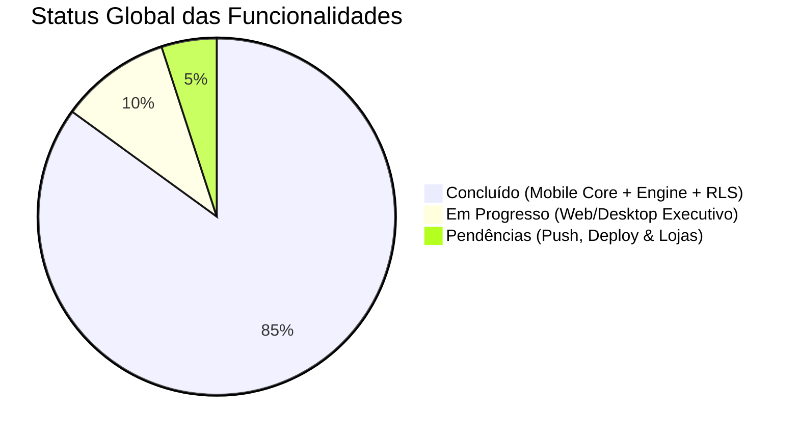
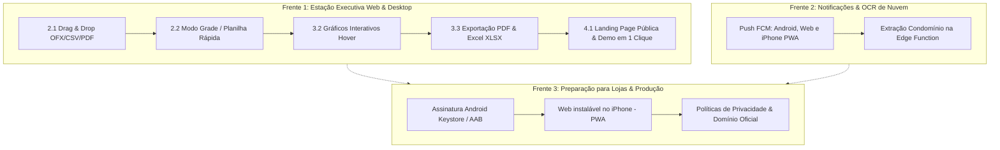

# 🗺️ Omni Lar: Plano Diretor Unificado (Mobile, Web & Produção)

Este plano unifica o **Roadmap de Engenharia & Produção** do aplicativo com o **Plano Estratégico de Diferenciação Web/Desktop**, estabelecendo uma visão única do que já foi construído e o caminho exato para a conclusão e publicação do produto nas lojas e na web.

---

## 📊 1. Painel Geral de Status do Projeto

| Frente / Plataforma | Status Geral | Cobertura de Testes |
|---|---|---|
| **Motor Financeiro & Super Pix** (Cents, Balde Comum, P2P, Caixinha) | 100% Concluído ✅ | 100% Automatizado |
| **Mobile Core** (Despesas, Recorrentes, Tarefas, Compras, Agenda, OCR) | 100% Concluído ✅ | 100% Automatizado |
| **Backend & Segurança** (Supabase RLS, Biometria RN07, Fila Offline AES) | 95% Concluído ✅ | 100% Automatizado |
| **Web & Desktop Executivo** (Dual-Pane, Atalhos, Importação, Relatórios) | 50% Concluído 🔄 | Testes em expansão |
| **Publicação & Lojas** (FCM Push, Keystore, Landing Page, Web instalável no iPhone) | 20% Concluído ⏳ | Preparação final |

> **Confiabilidade da Base:** **510 testes automatizados passando (100% verde)**, `flutter analyze` com zero erros e zero warnings (14/10/2026).

---

## 🏛️ 2. O Que Já Está 100% Implementado

### 💰 Motor Contábil & Financeiro
- [x] **Tratamento Estrito de Moeda:** 100% dos cálculos em centavos inteiros (`Money` em cents), eliminando erros de ponto flutuante.
- [x] **Três Modelos de Rateio:** Proporcional aos rendimentos, Dono 100% e Aportes Fixos (**Balde Comum** com compensação automática de excedentes).
- [x] **Despesas Compostas & Boletos Segmentados:** Suporte a faturas unificadas (ex: Condomínio dividindo Água, Gás, Taxa e Obras com donos diferentes).
- [x] **Contas Retroativas & Passivos:** Identificação automática de contas vencidas (`isOverdue`), arrasto de dívidas pendentes de ciclos anteriores e histórico navegável.
- [x] **P2P Flexível:** Parcelamento (1x a 12x), juros/desconto, pagamento parcial, anistia (perdão) e **empréstimos do lar via Caixinha / sem vencimento compulsório**.
- [x] **Global Clearing Engine (Super Pix):** Matriz de liquidação ótima que compensa dívidas coletivas e mútuas no menor número de transferências Pix.

### 📱 Experiência Mobile & Rotina
- [x] **Organização Completa:** Agenda do Lar (dia/semana/mês), Tarefas Domésticas e Lista de Compras compartilhadas.
- [x] **Realtime Sync:** Sincronização em tempo real entre moradores via Supabase Realtime Channels.
- [x] **Fila Offline Resiliente:** Operações salvas localmente com criptografia de hardware (`FlutterSecureStorage`) e sincronização pós-reconexão.
- [x] **Segurança e Risco (RN07):** Autenticação biométrica (`local_auth`) obrigatória para ações irreversíveis (Perdão, Renegociação e Fechamento do Ciclo).
- [x] **Identidade Visual:** Splash Screen nativa e customizada sem telas brancas, ícones adaptativos e logotipo vetorial responsivo.

### 🖥️ Estação Web/Desktop (Fase 1 Parcial)
- [x] **Dual-Pane no Fechamento do Ciclo:** Super Pix à esquerda e Memória de Cálculo aberta simultaneamente à direita dispensando modais.
- [x] **Dual-Pane na Tela Inicial (Home):** Painel estático [`ExpenseDetailDesktopPane`](file:///c:/Projetos/OmniLar/lib/features/finance/presentation/widgets/expense_detail_desktop_pane.dart) exibindo detalhes de despesas lado a lado.
- [x] **Sidebar Executiva Estável:** Largura fixa de 152px com indicador de status de conexão (`Online / Omni Cloud`).
- [x] **Atalhos Globais de Teclado:** `Ctrl + N` (nova despesa) e `Esc` (fechar painéis/modais).

---

## 🎯 3. Mapa de Pendências Unificado (O Que Falta Fazer)

---

### 🔹 Frente 1: Conclusão da Estação Executiva Web/Desktop

#### 1. Entrada de Dados em Lote (Drag & Drop)
- **Área de Soltura (`Dropzone`) na Web:** Permitir arrastar extratos bancários e faturas de cartão (`OFX`, `CSV`, `PDF`) direto na janela do navegador.
- **Conciliação Inteligente:** Leitura instantânea gerando o modal de "Rachar a Fatura", separando o que é da Casa, o que é de cada pessoa e o que vira empréstimo P2P.

#### 2. Produtividade & Modo Planilha
- **Modo Grade Tabular:** Visualização em tabela compacta de lançamentos com edição direta por células via teclado (`Tab`/`Enter`), ideal para conferência rápida de dezenas de gastos.
- **Atalho de Busca:** Foco imediato na barra de busca com `Ctrl + F`.

#### 3. Inteligência Analítica & Exportação
- **Gráficos com Hover:** Tooltips flutuantes nos gráficos de Fôlego e Categorias em telas grandes.
- **Exportação de Balanço Executivo:**
  - Geração de relatório consolidado em **PDF diagramado** (prestação de contas do mês).
  - Exportação da planilha do ciclo em formato **Excel (`.xlsx`)** estruturado.

#### 4. Landing Page Institucional & Onboarding Web
- **Apresentação Pública na Raiz (`/`):** Página institucional atraente explicando a proposta de valor (Super Pix, divisão justa, paz no lar).
- **Experimentar Demo em 1 Clique:** Acesso imediato à Demonstração funcional no navegador sem exigir login ou download.

---

### 🔹 Frente 2: Comunicação Ativa & IA de Nuvem

#### 1. Notificações Push (Android, Web e iPhone instalado)
- **Firebase Cloud Messaging (FCM)** como canal único: Android nativo, navegador e iPhone com o site instalado na Tela de Início (PWA, iOS 16.4+).
- **Sem APNs nativo:** o app não vai para a App Store, então o iPhone usa o Web Push pelo FCM. Detalhes e limitações na seção 9 da [arquitetura_tecnica.md](arquitetura_tecnica.md).
- Entregas: tabela `device_tokens`, edge function `notify` (FCM HTTP v1), `web/firebase-messaging-sw.js`, `manifest.json` revisado, botão "Ativar notificações" e passo a passo de instalação no iPhone.
- Disparo de alertas essenciais:
  - *"Fulano solicitou um empréstimo P2P de R$ X"*;
  - *"Nova tarefa atribuída a você: Comprar pó de café"*;
  - *"O ciclo financeiro fecha em 3 dias. Confira seus lançamentos."*

#### 2. OCR Especializado de Boletos de Condomínio
- Ajuste no prompt estruturado do Gemini na Edge Function `capture-read` para reconhecer automaticamente tabelas com taxas condominiais, rateio de água, gás e fundo de reserva, preenchendo a despesa composta com 1 clique no app.

---

### 🔹 Frente 3: Publicação & Lojas (Release Engineering)

#### 1. Android (Google Play)
- Configuração de `key.properties` e geração do keystore de release.
- Fixação do `applicationId: br.com.omnilar.app` e versionamento semântico no `build.gradle`.
- Geração do pacote de produção `.aab` (Android App Bundle).

#### 2. iOS (site instalado, sem App Store)
- O app **não será publicado na App Store**. No iPhone, o OmniLar é usado como site instalado na Tela de Início (PWA).
- Preparar a versão web para instalação: `manifest.json` com nome, `id`, cores e ícones do OmniLar; meta tags e `apple-touch-icon` no `web/index.html`; hospedagem em HTTPS no domínio oficial.
- Push no iPhone pelo FCM/Web Push (ver Frente 2).

#### 3. Conformidade & Suporte
- Publicação dos termos de uso e política de privacidade obrigatórios para as lojas.

---

## 📅 4. Cronograma de Execução Recomendado

| Etapa | Foco Principal | Entregáveis |
|---|---|---|
| **Sprint 1** | **Web Produtividade & Relatórios** | Drag & Drop OFX/CSV, Modo Grade, Exportação PDF/Excel |
| **Sprint 2** | **Landing Page & Vitrine Web** | Página pública na rota `/`, botão Demo 1-clique |
| **Sprint 3** | **Notificações Push & Edge IA** | Push pelo FCM (Android, web e iPhone instalado), OCR de condomínio |
| **Sprint 4** | **Engenharia de Release** | Assinatura do `.aab` e publicação na Google Play; versão web instalável (PWA) para iPhone |
