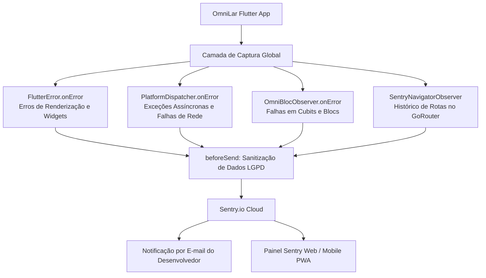

# Omni Lar — Plano de Monitoramento e Logs de Erro (Sentry Nativo)

Escrito em 19/10/2026. Documenta a estratégia, arquitetura e implementação para captura e recebimento de logs de erro em produção no OmniLar utilizando **Sentry** (`sentry_flutter`) de forma 100% nativa (sem necessidade de webhooks, Discord, Telegram ou bots terceiros), cobrindo Web, Android, iOS e Desktop com conformidade à LGPD e proteção de dados financeiros.

---

## 1. Visão Geral e Justificativa

### 1.1 O Problema
Atualmente, quando ocorre uma falha no aparelho de um morador (por exemplo, no supermercado com sinal fraco ou formulários com validações não atendidas), o erro fica restrito ao console de depuração local (`debugPrint` / `stderr`).
* O desenvolvedor não recebe alertas quando um erro acontece.
* É impossível saber se os usuários estão sofrendo falhas silenciosas sem que eles relatem manualmente.
* Falhas assíncronas do banco (Supabase) ou de rede não deixam rastro para reprodução.

### 1.2 Por que o Sentry Nativo?
1. **Zero Configuração de Webhook:** Ao criar a conta no Sentry, você já recebe notificações automáticas por **e-mail** em tempo real a cada novo erro.
2. **Painel Web & Mobile (PWA):** O painel do `sentry.io` é responsivo e pode ser adicionado à tela inicial do celular como um aplicativo (PWA).
3. **Breadcrumbs (Linha do Tempo):** Registra os últimos passos do morador até a falha (ex: *"Abriu Lista de Compras" ➔ "Marcou Item Leite" ➔ "Abriu Diálogo de Fechamento" ➔ "Clicou em Confirmar"*).
4. **Custo Zero:** O plano gratuito (*Developer*) oferece até **5.000 eventos/mês** com retenção de 30 dias, mais do que suficiente para o OmniLar.
5. **Simbolização e Stack Traces:** Mapeia exatamente o arquivo Dart e o número da linha onde ocorreu a exceção.

---

## 2. Arquitetura da Solução no Flutter

A captura de erros no OmniLar cobre as quatro camadas fundamentais do Flutter:



### 2.1 Os Quatro Pontos de Captura
1. **`FlutterError.onError`:** Captura falhas da engine do Flutter (erros de layout, exceções em `build()`).
2. **`PlatformDispatcher.instance.onError`:** Ponto de entrada moderno do Dart para capturar erros assíncronos não tratados (falhas de conexão, chamadas RPC do Supabase que estouraram sem `try/catch`).
3. **`BlocObserver.onError`:** Intercepta qualquer erro disparado em todos os Cubits da aplicação (`ShoppingCubit`, `FinanceCubit`, `AuthCubit`, `CalendarCubit`, etc.).
4. **`SentryNavigatorObserver`:** Registra a transição de telas no `GoRouter` como migalhas de pão (*breadcrumbs*).

---

## 3. Privacidade e Proteção de Dados Financeiros (LGPD)

O OmniLar lida com despesas financeiras, saldos de caixinha e dívidas entre moradores. É **mandatório** que dados sensíveis não vazem para os servidores do Sentry.

### 3.1 Regras de Sanitização
* **Nunca registrar:** Senhas, tokens JWT do Supabase, números de cartão de crédito/débito, código de barras/linhas digitáveis completas de boletos ou chaves Pix.
* **Anonimização de Usuário:** O morador deve ser identificado apenas pelo seu UUID interno (`user_id`) e `house_id`. Nomes completos e e-mails pessoais não devem ser enviados como identificador principal.
* **Filtro `beforeSend`:** Todas as mensagens passam por uma função que remove dados sensíveis antes do envio para a nuvem.
* **Screenshots Desativadas:** `options.attachScreenshot = false` para garantir que telas com comprovantes bancários ou saldos familiares nunca sejam gravadas como imagem.

Exemplo de implementação da sanitização:
```dart
SentryOptions configureSentry(SentryOptions options) {
  options.dsn = const String.fromEnvironment('SENTRY_DSN');
  options.tracesSampleRate = 0.2; // 20% das transações de desempenho para poupar cota
  options.attachScreenshot = false;
  options.sendDefaultPii = false;
  
  options.beforeSend = (SentryEvent event, {Hint? hint}) {
    // Remove cabeçalhos de autorização que possam conter tokens JWT
    event.request?.headers.remove('Authorization');
    event.request?.headers.remove('apikey');
    
    return event;
  };
  
  return options;
}
```

---

## 4. Passo a Passo de Implementação

### Passo 1: Dependência no `pubspec.yaml`
```yaml
dependencies:
  sentry_flutter: ^8.14.0
```

### Passo 2: Observer para os Cubits (`lib/core/logging/omni_bloc_observer.dart`)
```dart
import 'package:flutter_bloc/flutter_bloc.dart';
import 'package:sentry_flutter/sentry_flutter.dart';

class OmniBlocObserver extends BlocObserver {
  @override
  void onError(BlocBase bloc, Object error, StackTrace stackTrace) {
    super.onError(bloc, error, stackTrace);
    
    Sentry.captureException(
      error,
      stackTrace: stackTrace,
      withScope: (scope) {
        scope.setTag('bloc', bloc.runtimeType.toString());
        scope.setContexts('bloc_state', {
          'state': bloc.state.toString(),
        });
      },
    );
  }
}
```

### Passo 3: Inicialização no `lib/main.dart`
Substituir o `runApp` pelo envelope seguro do Sentry:

```dart
import 'package:sentry_flutter/sentry_flutter.dart';

Future<void> main() async {
  WidgetsFlutterBinding.ensureInitialized();
  
  const sentryDsn = String.fromEnvironment('SENTRY_DSN');

  if (sentryDsn.isEmpty) {
    // Desenvolvimento local ou sem DSN configurado: roda normal sem enviar logs
    Bloc.observer = OmniBlocObserver();
    await _bootstrapApp();
    runApp(const OmniLarApp());
  } else {
    // Produção com monitoramento nativo do Sentry
    await SentryFlutter.init(
      (options) {
        options.dsn = sentryDsn;
        options.tracesSampleRate = 0.2;
        options.attachScreenshot = false; // Não capturar tela para proteger dados financeiros
        options.sendDefaultPii = false;   // Não enviar IP ou dados pessoais
        options.environment = kReleaseMode ? 'production' : 'development';
      },
      appRunner: () async {
        Bloc.observer = OmniBlocObserver();
        await _bootstrapApp();
        runApp(const OmniLarApp());
      },
    );
  }
}
```

### Passo 4: Registro no `GoRouter` (`lib/core/router/app_router.dart`)
Para registrar o histórico de telas acessadas sem esforço manual:
```dart
static final router = GoRouter(
  observers: [
    SentryNavigatorObserver(), // Adiciona breadcrumb a cada troca de rota
  ],
  routes: [ ... ],
);
```

### Passo 5: Vinculação de Contexto do Usuário
Ao autenticar o morador (no `AuthCubit` ou após o login), associar a sessão ao ID da casa:
```dart
Sentry.configureScope((scope) {
  scope.setUser(SentryUser(id: user.id));
  scope.setTag('house_id', houseId);
});
```
E no logout:
```dart
Sentry.configureScope((scope) => scope.setUser(null));
```

---

## 5. Como Receber Alertas e Acessar os Logs (100% Nativo Sentry)

Você **não precisa de nenhum serviço extra, nem webhook, nem bot**:

### 5.1 Alertas Nativos por E-mail
* O Sentry já vem configurado para enviar um e-mail automaticamente no instante em que um novo erro ocorrer no app.
* O e-mail contém:
  * O nome do erro e a mensagem.
  * O arquivo e a linha onde ocorreu.
  * O dispositivo (Android, navegador Web, etc.).
  * Um botão direto para abrir a tela de detalhe do erro.
* Com isso, o aviso chega no seu celular via aplicativo de e-mail (Gmail, Outlook, etc.) imediatamente.

### 5.2 Acesso pelo Celular via PWA (Atalho de App)
O painel do Sentry (`sentry.io`) é responsivo e funciona perfeitamente em telas de celulares:
1. Abra `https://sentry.io` no navegador do seu celular (Chrome no Android ou Safari no iPhone).
2. Faça login na sua conta.
3. No menu do navegador, toque em **"Adicionar à tela inicial"** (ou *"Instalar aplicativo"*).
4. Um ícone do Sentry será criado no seu celular. Ao tocar nele, ele abre em tela cheia como se fosse um app nativo, permitindo consultar todas as falhas, breadcrumbs e stack traces na palma da mão.

---

## 6. Como Compilar com o Sentry sem Expor Chaves no Git

O `SENTRY_DSN` não precisa ser fixado no código-fonte. Ele pode ser injetado durante o build:

* **No build Web:**
  ```bash
  flutter build web --release --dart-define=SENTRY_DSN=https://chave@o000.ingest.sentry.io/000
  ```
* **No build Android APK / Bundle:**
  ```bash
  flutter build apk --release --dart-define=SENTRY_DSN=https://chave@o000.ingest.sentry.io/000
  ```

Se a variável `SENTRY_DSN` não for informada, o app funciona normalmente sem tentar enviar logs para a nuvem, garantindo total isolamento em ambientes de testes e emuladores.

---

## 7. Próximos Passos para Ativação

1. Criar um projeto gratuito do tipo **Flutter** em [sentry.io](https://sentry.io).
2. Copiar a URL do DSN gerada.
3. Adicionar o pacote `sentry_flutter` ao `pubspec.yaml`.
4. Implementar o `OmniBlocObserver` e configurar o `SentryFlutter.init` no `main.dart`.
5. Fazer login no `sentry.io` no celular e adicionar o atalho à tela inicial.
