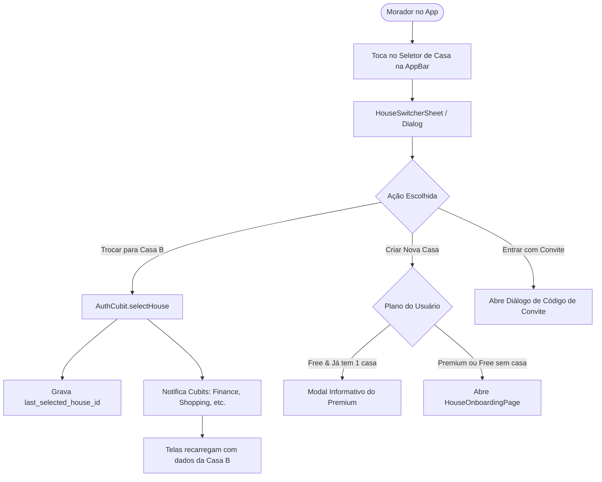

# Omni Lar — Plano de Múltiplas Casas e Gestão de Contexto (Modo Premium)

Escrito em 20/10/2026. Documenta a arquitetura, as regras de negócio, os fluxos no app e a experiência do usuário para permitir que um morador participe e gerencie mais de uma casa no Omni Lar, diferenciando as possibilidades do plano **Free** e do plano **Premium** com tratamento contextual de notificações e troca suave de ambientes.

---

## 1. Visão Geral e Justificativa

No dia a dia, a vida financeira e a rotina de muitas famílias não se restringem a um único teto físico:
* **Casa da Cidade + Casa de Praia / Sítio:** Controle das contas fixas e reformas da casa de veraneio compartilhada entre parentes.
* **Apoio Familiar:** Um filho que administra as despesas e saúde da casa dos pais idosos paralelamente à sua própria residência.
* **Jovens e Estudantes:** Moradia dividida com colegas de faculdade (república) e despesas da casa da família aos finais de semana.
* **Imóvel de Aluguel Compartilhado:** Rateio de manutenção e condomínio de um imóvel herdado ou gerido em conjunto.

Permitir que uma mesma conta gerencie múltiplos lares sem precisar deslogar ou criar e-mails alternativos é um dos maiores diferenciais de conveniência do **Omni Lar Premium**.

---

## 2. Planos (Free vs. Premium) e Postura de UX

### 2.1. Alocação do Recurso

| Recurso | Plano Free | Plano Premium |
|---|---|---|
| **Casas que a conta pode criar (como Dono)** | **1 casa** | **Até 3 casas** *(configurável no painel admin)* |
| **Casas em que pode participar (como Convidado)** | Ilimitado | Ilimitado |
| **Recursos da Casa criada** | Limites do Free (10 IAs/dia, até 4 moradores) | Herda o plano Premium do dono (100 IAs/dia, 20 moradores, anexo de notas Modelo A) |
| **Alternar entre casas no app** | Disponível para quem participar de mais de 1 casa | Totalmente integrado |

> [!NOTE]
> Um usuário Free que for convidado para a casa de um amigo ou familiar pode participar de mais de uma casa normalmente. O limite de 1 casa aplica-se à **criação de novas casas como Dono**.

### 2.2. Diretriz de UX: Convidativo e Respeitoso (Sem Paywall Agressivo)
Seguindo o princípio transversal do Omni Lar:
* No seletor de casas, a opção `+ Criar nova casa` fica sempre visível.
* Se um usuário no plano Free que já é dono de uma casa tocar em `+ Criar nova casa`, o app **não trava nem exibe propaganda invasiva**. Exibe um diálogo calmo e explicativo:
  > *"No plano Free você pode criar e administrar 1 casa. O **Omni Lar Premium** permite gerenciar até 3 casas (casa de praia, sítio, apoio aos pais ou república) na mesma conta."*
  > *Opções: [Conhecer o Premium] e [Agora não]*

---

## 3. Diagnóstico Técnico: Por que a base já está pronta?

A análise da arquitetura do Omni Lar revelou que a base de dados e os contratos de código foram desenhados prevendo múltiplas casas:

1. **Chave Composta no Banco:**  
   Na tabela `public.house_members`, a chave de unicidade é `UNIQUE(house_id, user_id)`. O PostgreSQL aceita nativamente que o mesmo usuário pertença a múltiplas casas.
2. **Políticas de Segurança RLS Isoladas:**  
   Todas as tabelas (`house_expenses`, `shopping_items`, `p2p_loans`, `savings_vaults`, etc.) possuem RLS baseado em `is_house_member(house_id)`. O isolamento entre casas é absoluto no nível do banco.
3. **Gatilho de Limite Existente (Migration 0069):**  
   O gatilho `guard_house_creation_account()` já consulta `plan_limits('houses_owned')`. O banco de dados já bloqueia automaticamente tentativas de criar além da quota do plano.
4. **Datasources Dinâmicos:**  
   Todos os repositórios do app obtêm o ID da casa via função dinâmica no Service Locator:  
   `getCurrentHouseId: () => sl<AuthRepository>().currentHouse?.id ?? ''`.
5. **Cache Offline Isolado:**  
   O `OfflineSnapshot` já utiliza chaves compostas incluindo o ID da casa (ex: `'members_$_houseId'`).

---

## 4. Regras de Negócio Fundamentais

### RN01: Persistência da Casa Ativa
O app deve armazenar localmente o identificador da última casa selecionada (`last_selected_house_id_${userId}`). Ao reiniciar o app ou restaurar a sessão, se o morador ainda fizer parte daquela casa, ela deve ser aberta diretamente. Caso a casa tenha sido deletada ou o morador tenha saído, o app seleciona a primeira casa disponível.

### RN02: Alternância Suave de Contexto
Ao trocar de casa através do seletor:
1. O `AuthRepository.selectHouse(houseId)` atualiza o `currentHouse`.
2. O `AuthCubit` emite o novo estado com a casa ativa.
3. Todos os Cubits que possuem dados em tela (`FinanceCubit`, `ShoppingCubit`, `CalendarCubit`, `P2PCubit`, `NotificationsCubit`) devem limpar os dados antigos e disparar o carregamento imediato do novo ciclo e registros da nova casa.
4. A navegação permanece na mesma aba (ex: se o usuário estava na aba "Casa", continua na aba "Casa", mas agora com os números da nova casa).

### RN03: Inteligência de Notificações Push (Contexto Condicional)
O morador deve saber de imediato se o alerta requer sua atenção na residência principal ou secundária:
* **Usuário com apenas 1 casa:**  
  * Título: `Nova despesa lançada`  
  * Mensagem: `Carlos lançou "Internet" de R$ 120,00`
* **Usuário com 2 ou mais casas:**  
  * Título: `[Casa de Praia] Nova despesa lançada`  
  * Mensagem: `Carlos lançou "Manutenção" de R$ 250,00`

### RN04: Toque no Push com Troca Automática de Contexto (Deep Link Cross-House)
Quando o morador tocar em uma notificação pertencente a uma casa que não seja a atualmente selecionada no app:
1. O app detecta que o `house_id` da notificação difere da casa ativa.
2. O app executa a troca automática da casa ativa em segundo plano (`selectHouse`).
3. O `GoRouter` navega até a tela específica do item (ex: `/despesas/detalhe/...`).
4. Evita que o usuário veja erros de "registro não encontrado" por incompatibilidade de casa.

### RN05: Central de Notificações In-App
Na tela interna de notificações (`NotificationsPage`):
* Se o morador participa de apenas 1 casa: a listagem é limpa, sem tags adicionais.
* Se o morador participa de mais de uma casa: cada card exibe um chip sutil com o nome da respectiva casa (ex: `🏷️ Casa de Praia`). Tocar no item realiza a troca de casa e abre o detalhe.

---

## 5. Arquitetura e Fluxo de Dados

---

## 6. Passo a Passo de Implementação Técnica

### Fase 1: Camada de Autenticação e Repositório
* **`lib/features/auth/data/datasources/supabase_auth_datasource.dart`:**
  * Implementar gravação e leitura de `last_selected_house_id_${userId}` via `SharedPreferences`.
  * Em `getUserHouses()`, garantir que a lista seja retornada ordenada por última ativação ou ordem de entrada.
* **`lib/features/auth/presentation/cubit/auth_cubit.dart`:**
  * Adicionar método `Future<void> switchHouse(String houseId)`.
  * Atualizar o `AuthState` para expor `List<House> userHouses`.

### Fase 2: Orquestração de Recarga dos Cubits
* Adicionar um mecanismo limpo (via `StreamSubscription` em `AuthRepository.houseChanges` ou callback no `AppRouter`/Cubit) para disparar:
  * `FinanceCubit.loadCycleData()`
  * `ShoppingCubit.loadShoppingData()`
  * `CalendarCubit.loadCalendarData()`
  * `P2PCubit.loadLoans()`
  * `NotificationsCubit.load()`
  sempre que o `currentHouse.id` mudar.

### Fase 3: Componente Visual (House Switcher)
* Criar `lib/core/widgets/house_switcher_dialog.dart`:
  * Estilo *bottom sheet* no mobile e *popover/dialog* no desktop/web.
  * Cabeçalho com o nome da casa atual e selo de Morador/Dono.
  * Lista das outras casas com botão de troca instantâneo.
  * Divisor com opções de rodapé:
    * `+ Criar nova casa` (com badge discreto ⭐ Premium se aplicável).
    * `+ Entrar com código de convite`.
* Integrar o toque no título da AppBar da tela Home (`HomePage`) e na Sidebar do Desktop (`ScaffoldWithNavBar`).

### Fase 4: Inteligência de Notificações
* **Edge Function `supabase/functions/notify/index.ts`:**
  * Na montagem da mensagem push, verificar a contagem de casas ativas do destinatário.
  * Se `userHouseCount > 1`, adicionar o prefixo `[NomeDaCasa]` no título da notificação.
  * Garantir que o payload de dados contenha sempre `house_id`.
* **Push Service no App (`lib/features/notifications/data/push/push_service.dart`):**
  * Ao receber o clique no push com `house_id`, invocar `sl<AuthRepository>().selectHouse(houseId)` antes de despachar o `deeplink`.
* **Card In-App (`lib/features/notifications/presentation/pages/notifications_page.dart`):**
  * Exibir etiqueta da casa nos itens quando `userHouses.length > 1`.

---

## 7. Critérios de Aceite e Testes

1. **Alternância Imediata:** Ao alternar de casa, o app não deve exibir telas de erro e deve atualizar os valores do ciclo da nova casa em menos de 1 segundo.
2. **Persistência de Sessão:** Fechar e reabrir o app mantém o morador na última casa selecionada.
3. **Travas do Plano:**
   * Usuário Free com 1 casa como dono é impedido de criar a segunda, recebendo o diálogo do Premium sem travar o app.
   * Usuário Premium consegue criar a 2ª e a 3ª casa com sucesso.
4. **Notificações Precisas:**
   * Morador com 1 casa recebe: `"Nova despesa lançada"`.
   * Morador com 2 casas recebe: `"[Casa de Praia] Nova despesa lançada"`.
   * Tocar no push da casa inativa troca o ambiente e abre a despesa perfeitamente.
