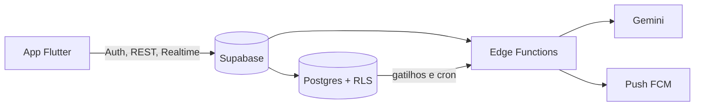

# Omni Lar

Aplicativo para quem mora junto organizar **o dinheiro e a rotina da casa num só lugar**: Caixa da Casa, rateio das despesas, fechamento do ciclo com um único Pix, empréstimos entre moradores, caixinhas, agenda, tarefas, lista de compras, importação de fatura e leitura de nota e boleto.

**Demo:** https://omnilar.web.app (instalável no iPhone como PWA) · **Android:** APK de release

> **Sobre este projeto:** foi desenvolvido por mim, **com apoio intenso de IA (Claude)** na escrita do código. Eu defini o produto, as regras de negócio e a arquitetura, revisei as decisões e testo o app com sessão real. A documentação em [`Documentacao/`](Documentacao/) registra essas decisões.

## O que ele faz

- **Dinheiro da casa:** Caixa da Casa por ciclo, três modelos de rateio (porcentagem, aportes fixos e por categoria), despesas compostas, contas recorrentes e cartão dentro da fatura.
- **Fechamento do ciclo (Super Pix):** um motor de compensação cruza o Caixa da Casa com as dívidas entre moradores e entrega um único fechamento por ciclo, com memória de cálculo.
- **Empréstimos e caixinhas:** parcelas, pagamento parcial, perdão, renegociação e metas com prazo.
- **Importação e conciliação:** fatura e extrato (OFX, CSV, PDF e foto), com regras aprendidas.
- **Captura:** QR Code de NFC-e, boleto e foto lida por IA, sempre com **revisão humana antes de gravar**.
- **Rotina:** agenda com RSVP e recorrência, tarefas e lista de compras em tempo real.
- **Conta e administração:** cadastro com código de confirmação, aprovação de contas, planos Free/Premium e painel admin.
- **Notificações:** sino em tempo real, lembretes agendados (`pg_cron`) e push via FCM.

## Arquitetura



| Camada | Tecnologia |
| --- | --- |
| App | Flutter, Dart (Android e web) |
| Estado | Bloc/Cubit (`flutter_bloc`), `get_it` para injeção de dependência |
| Navegação | `go_router` |
| Backend | Supabase: Postgres com RLS, Auth, Realtime, Storage e Edge Functions |
| Push e hospedagem | Firebase Cloud Messaging e Firebase Hosting |
| Erros | Sentry |
| CI | GitHub Actions (análise e testes) |

Algumas decisões que vale conhecer:

- **Organização por feature** (`lib/features/*`), cada uma com `data`, `domain` e `presentation`; o domínio é Dart puro e testável.
- **Modo demo:** cada fonte de dados tem a versão Supabase e a de demonstração, então a suíte de testes roda sem backend.
- **Fila offline** para lançamentos simples, com reenvio ao voltar a rede.
- **Segurança no banco:** isolamento por casa via RLS; o fechamento é gravado numa transação atômica.
- **122 migrations** versionadas em `supabase/migrations`.

## Testes

Mais de 180 arquivos de teste (domínio, cubits, serviços e widgets) rodam contra o modo demo.

```bash
flutter analyze
flutter test
```

## Como rodar

Pré-requisitos: Flutter. Para ter o seu próprio backend, um projeto Supabase e um projeto Firebase.

```bash
flutter pub get
flutter run -d chrome \
  --dart-define=SUPABASE_URL=https://SEU-PROJETO.supabase.co \
  --dart-define=SUPABASE_ANON_KEY=SUA_CHAVE_PUBLICA
```

Aplique as migrations de `supabase/migrations` no seu projeto. Sem os `--dart-define`, o app aponta para o projeto de nuvem do autor (a chave embutida é a **publicável**, pensada para ficar no cliente; quem protege os dados é a RLS). Os testes automatizados não precisam de backend.

## Limitações conhecidas

- O push ainda não foi validado em um aparelho real.
- Sem cache local: sem rede, as listas não carregam (só a fila offline de lançamentos simples).
- O cálculo do fechamento roda no app e o banco confere; mover tudo para o banco está planejado em [`fechamento_no_banco.md`](Documentacao/fechamento_no_banco.md).
- Uso real hoje: uma casa, duas contas. Não está na Google Play.

## Documentação

Comece por [`plano_diretor_unificado.md`](Documentacao/plano_diretor_unificado.md) (o que funciona e o que falta) e [`arquitetura_tecnica.md`](Documentacao/arquitetura_tecnica.md).

## Licença

[PolyForm Noncommercial 1.0.0](LICENSE): o código pode ser lido, estudado e usado para fins não comerciais. Uso comercial não está incluído.

## Autor

Kelvynn Bordin Calegari · [LinkedIn](https://www.linkedin.com/in/kelvynn-bordin-calegari)
